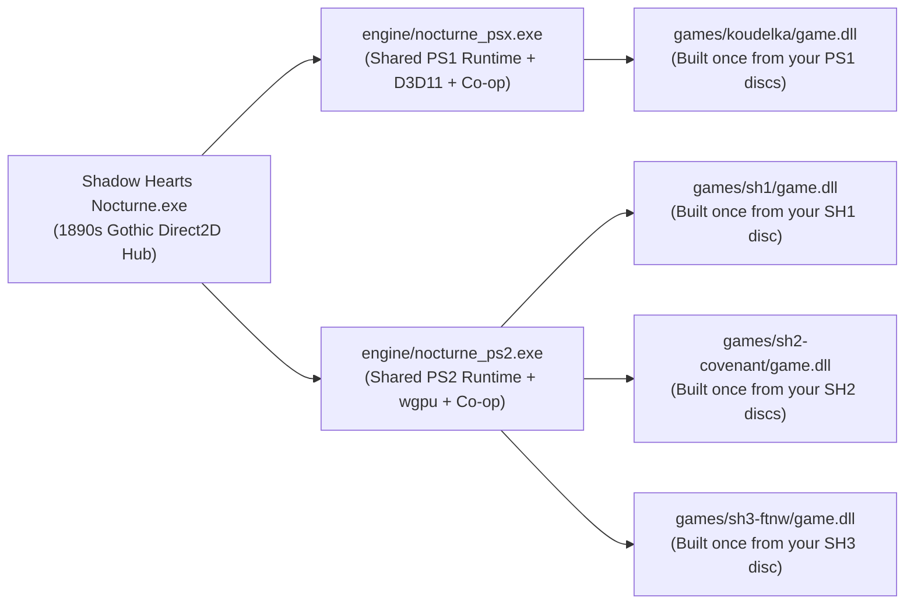

<div align="center">

# 🌙 Shadow Hearts: Nocturne

**Native Windows PC Port Collection of *Koudelka* & the *Shadow Hearts* Quadrilogy (PS1 + PS2) — Active Beta**

[](https://github.com/NfgOdin/Shadow-Hearts-Nocturne/actions/workflows/ci.yml)
[](https://github.com/NfgOdin/Shadow-Hearts-Nocturne/releases)
[](https://github.com/NfgOdin/Shadow-Hearts-Nocturne/releases)
[](LICENSE)
[](#supported-collection-titles)

*Unified inside a single 1890s Gothic Direct2D Command Hub (`Shadow Hearts Nocturne.exe`), powered by native C++20 static recompilation (`psxrecomp` + customized `ps2-native-recomp`) with a Shared Engine + Per-Game `game.dll` architecture for fast Quick Updates, a clean-room *Covenant* Director's Cut Upgrader, *Koudelka* high-poly `.glb` 3D Model Swaps, Online & LAN Co-op (Beta), a 4-Layer Lua/C++ Mod Engine, an interactive Grimoire Archives Library, and a Collectible Card Album.*

[**⬇ Download Installer (`Install Shadow Hearts Nocturne.cmd`)**](https://github.com/NfgOdin/Shadow-Hearts-Nocturne/releases) · [**🚀 Quick Start**](#quick-start-5-minutes-to-play) · [**⚔ Director's Cut**](#tutorial-directors-cut) · [**🗿 3D Model Swaps**](#tutorial-model-swap) · [**👥 Co-op (Beta)**](#tutorial-coop) · [**📖 All Tutorials**](#complete-step-by-step-tutorials) · [**🛠 FAQ**](#troubleshooting--faq)

</div>

<!-- Screenshot slot: Hero / Gothic Command Hub Launcher (e.g., ) -->

---

> [!IMPORTANT]
> **Legal Notice — Bring Your Own Discs (BYOD):**
> This repository and its releases contain **ZERO** copyrighted game code, Sony BIOS files, disc images, extracted binaries, overlays, textures, audio, or saves. You must supply your own legally dumped retail disc images (`.iso`, `.chd`, `.cso`, or `.bin`/`.cue`). Each game's code is statically recompiled **locally on your own PC** into `games\<slug>\game.dll`.

---

> [!WARNING]
> **Active Beta Software — Nothing Is 100% Tested or Bug-Free!**
> **Shadow Hearts: Nocturne** is an **ongoing, community-tested Beta project**. Nothing in this collection is considered "100% stable" or completely bug-free—every game, graphics option, mod layer, upgrader, and Co-op feature still needs real-world playtesting across different PCs and full playthroughs.
>
> **We genuinely need testers!** If you run into crashes, visual glitches, audio quirks, Co-op desyncs, or broken UI, please report them on [GitHub Issues](https://github.com/NfgOdin/Shadow-Hearts-Nocturne/issues) (include your commit hash from **Launcher → Tools → Updates**, your GPU/OS, and logs from `games\<slug>\logs\` or `F9` in PS2 / `F10` in Co-op). Use **Launcher → Tools → Updates → Quick Update** to grab fixes quickly!

---

## Quick Navigation (Table of Contents)

- [Supported Collection Titles](#supported-collection-titles)
- [How It Works (Shared Engine + `game.dll` Fast Updates)](#how-it-works-shared-engine--gamedll-fast-updates)
- [Highlights & Feature Showcase](#highlights--feature-showcase)
  - [🏰 4-Panel Gothic Command Hub, Grimoire Archives & Card Album](#-4-panel-gothic-command-hub-grimoire-archives--card-album)
  - [🕯 Koudelka (PS1) Native Engine, Visual Remaster & `.glb` 3D Model Swaps](#-koudelka-ps1-native-engine-visual-remaster--glb-3d-model-swaps)
  - [🎨 Shadow Hearts I / II / III (PS2) Native Engine, True Hor+ & Wave G Post-FX](#-shadow-hearts-i--ii--iii-ps2-native-engine-true-hor--wave-g-post-fx)
  - [⚔ Shadow Hearts: Covenant — Clean-Room Director's Cut Upgrader (Beta)](#-shadow-hearts-covenant--clean-room-directors-cut-upgrader-beta)
  - [👥 Online & LAN Turn-Authority Co-op Multiplayer *(Beta)*](#-online--lan-turn-authority-co-op-multiplayer-beta)
  - [🧩 4-Layer Gameplay Mod Engine, Bundled Mods & Mod SDK](#-4-layer-gameplay-mod-engine-bundled-mods--mod-sdk)
  - [🎯 Judgment Ring Dojo, `F1` Quick Menu, Save States & 310 Trophies](#-judgment-ring-dojo-f1-quick-menu-save-states--310-trophies)
- [System Requirements](#system-requirements)
- [Quick Start (5 Minutes to Play)](#quick-start-5-minutes-to-play)
- [Complete Step-by-Step Tutorials](#complete-step-by-step-tutorials)
  - [1. Fresh Install Walkthrough (No Git or Visual Studio Required)](#tutorial-install)
  - [2. Preparing & Verifying Your Disc Images](#tutorial-discs)
  - [3. Updating (Quick Updates & Stable vs. Nightly)](#tutorial-updating)
  - [4. Direct Launch & Steam Shortcuts (`--play`)](#tutorial-direct-launch)
  - [5. Shadow Hearts: Covenant — Director's Cut Permanent Upgrader (Regular & UnDub)](#tutorial-directors-cut)
  - [6. Koudelka — High-Poly `.glb` 3D Skinned Model Swaps](#tutorial-model-swap)
  - [7. HD Texture Packs, Offline `.PKB` Extraction & AI 4× Upscaling](#tutorial-hd-textures)
  - [8. HD FMV Packs & AI Video Upscaling](#tutorial-hd-fmvs)
  - [9. Gameplay Mods, Bundled Catalog & Nocturne Mod Studio & SDK](#tutorial-mods)
  - [10. Online & LAN Turn-Authority Co-op Multiplayer *(Beta)*](#tutorial-coop)
  - [11. Save Management, Memory Cards, Save States & Backups](#tutorial-saves)
  - [12. Baking Captured VU1/VU0 Vector Microprograms](#tutorial-vu1)
  - [13. Controls, Gamepad Setup & Full Keyboard Shortcuts](#tutorial-controls)
- [Troubleshooting & FAQ](#troubleshooting--faq)
- [Folder Layout Reference](#folder-layout-reference)
- [Building & Testing From Source (Developers)](#building--testing-from-source-developers)
- [Credits & License](#credits--license)

---

## Supported Collection Titles

> All 4 games run at **locked native 60 FPS** (50 Hz for PAL mode) for accurate timing, audio, and cutscenes, with on-demand **Turbo Fast-Forward** (`Tab` hold / `F3` toggle). Expect Beta quirks and please report issues you discover!

| # | Chronicle | Platform & Required Serial(s) | Discs | Local Game Module | Key Features & Enhancements *(Active Beta)* |
|---|---|---|---|---|---|
| **0** | **Koudelka** *(1898)* | PS1 NTSC-U `SLUS-01051` / `01100` / `01101` / `01102` | 4 | `games\koudelka\game.dll` | Native R3000A + GTE static recomp, D3D11 Hardware GPU (`1×`–`8×`) & CPU Software (`1×`–`4×`), PGXP Subpixel + Persp UV, 5 Visual Presets (FXAA, Gothic Bloom, Vignette, AMD CAS, AMD FSR 1.0, 1898 Candlelight, 24-bit De-Dither), **Layer 1d `.glb` 3D Skinned Model Swaps**, SPU1 Hardware Reverb + 4-tap ADPCM, **50-Trophy Gallery**, Collectible Card drops, `PSXSTAT3` save states, 4-disc auto-swap, **Online/LAN Co-op (up to 3P, Beta)** |
| **I** | **Shadow Hearts** *(1913)* | PS2 NTSC-U `SLUS-20347` | 1 | `games\sh1\game.dll` | Native AOT static recomp, True Hor+ Widescreen (`16:10` / `16:9` / `21:9` / `32:9` / `Auto`) with 1:1 2D field alignment protection, low-latency Judgment Ring pipeline, **75-Trophy Gallery**, Area Autosave + LZ4 Save States, Offline `.PKB` Texture (`~1,000+` PNGs) & FMV (`19` cutscenes) Extractor, 1-Click VU1 Baker, Co-op *(up to 4P, Beta — untested)* |
| **II** | **Shadow Hearts: Covenant** *(1915)* | PS2 NTSC-U `SLUS-21041` (D1) / `SLUS-21044` (D2) *(+ optional JP DC `SLPS-73214`)* | 2 | `games\sh2-covenant\game.dll` | Native AOT static recomp (`SLUS_210.41` + `MWo3` overlays), Disc 1 ↔ Disc 2 auto-swap with NTFS hardlink deduplication, **Clean-Room Director's Cut Permanent Upgrader (Regular & UnDub + English `.MSC` translation engine)**, True Hor+ Widescreen + HUD Pillar-Anchor, Live Ring HUD & Strict Ring Mode, **110-Trophy Gallery**, Area Autosave + LZ4 Save States, Offline `.PKB` Extractor (~5,650 PNGs + 40 FMVs), Co-op *(up to 4P, Beta — untested)* |
| **III** | **Shadow Hearts: From the New World** *(1929)* | PS2 NTSC-U `SLUS-21326` | 1 | `games\sh3-ftnw\game.dll` | Native AOT static recomp (`SLUS_213.26` + `.CPX` overlays), True Hor+ Widescreen + HUD Pillar-Anchor, Live Ring HUD & Strict Ring Mode, **75-Trophy Gallery**, Area Autosave + LZ4 Save States, Offline `.PKB` Texture & FMV Extractor, `1×`–`8×` Launcher / custom internal scale + Depth Post-FX, Co-op *(up to 4P, Beta — untested)* |

---

## How It Works (Shared Engine + `game.dll` Fast Updates)

**Shadow Hearts: Nocturne** separates the open-source shared engine binaries from your locally compiled game modules:



- **Compile each game once:** Your discs are unpacked into fast SSD folders and statically recompiled into `games\<slug>\game.dll` on your own machine.
- **Fast Quick Updates:** Clicking **Quick Update** in the Launcher downloads SHA-256-verified shared engine binaries (`Shadow Hearts Nocturne.exe`, `engine\nocturne_ps2.exe`, `engine\nocturne_psx.exe`), upgrades official bundled mods (preserving your `settings.json`), and restarts—typically in a few seconds without recompiling your games.
- **Automatic ABI safety:** Every `game.dll` exports an ABI version + struct layout fingerprint. Whenever an engine update changes the recompiler ABI (for example, the PS2 ABI v2 update for True Hor+ ultrawide projection), the updater detects it automatically and rebuilds only the affected `game.dll` while keeping your saves, settings, mods, and unpacked discs intact.

---

## Highlights & Feature Showcase

### 🏰 4-Panel Gothic Command Hub, Grimoire Archives & Card Album
<!-- Screenshot slot: Launcher Home / Grimoire Library / Card Album -->
- **Quadrilogy Command Hub (`Shadow Hearts Nocturne.exe`):** Mouse, Keyboard, and XInput Gamepad navigation across all 4 chronicles (*Koudelka 1898*, *Shadow Hearts 1913*, *Covenant 1915*, *From the New World 1929*) with era-specific palettes, animated Judgment Ring crests, custom cover art (`games\<slug>\cover.png`), live trophy/save summaries, playtime tracking, window maximize/resize with saved geometry, a 48-bitmap LRU VRAM cache, and unfocused idle power-saving.
- **1890s Grimoire Archives & Lore Library:** Shelve your own Manga, Strategy Guides, Novels & Lore, or Custom books inside `library\` (and per-game Manuals on each game's Home Hub), browse with animated book/page-flip effects and silk ribbon bookmarks, toggle **Hide Unshelved**, and read directly in the built-in **PDF & CBZ Reader**.
- **Collectible Card Album *(Beta)*:** Includes a 20-card Gothic Tarot collection with rarity/foil variants, Essence Tarot Draw, and a 3D-tilt Card Inspector in the Launcher. Live in-game card drops (from trophies, battles, and pickups) are currently wired in **Koudelka** and still pending for the PS2 trilogy.
- **Built-In Tools Hub:** Stable (`main`) / Nightly (`nightly`) Quick Updater, System Health diagnostics, HD Texture/FMV Pack & Gameplay Mod Manager (with GitHub Mod Catalog browser, per-mod settings UI, drag/reorder, conflict hints), offline `.PKB` extraction & AI upscaling, Director's Cut Upgrader, save bundle export, and screenshot lightbox.

### 🕯 Koudelka (PS1) Native Engine, Visual Remaster & `.glb` 3D Model Swaps
<!-- Screenshot slot: Koudelka D3D11 HD + Visual Remaster / .glb Model Swap -->
- **D3D11 Hardware GPU (`1×`–`8×`) + Software CPU (`1×`–`4×`) + PGXP:** Hardware rasterizer with draw-state caching, D3D11 device-lost recovery, **PGXP Subpixel Vertex Precision + Perspective-Correct UVs** (greatly reduces PS1 polygon wobble and texture warping), Nearest / Bilinear / Sharp-Bilinear 3D filtering, and DXGI `ALLOW_TEARING` VSync-Off support.
- **Visual Remaster Pack (Live in `F1 → GRAPHICS`):** Real-time **FXAA**, **AMD FSR 1.0 (EASU)**, **AMD CAS Sharpening**, **Gothic Candlelight Bloom**, **Filmic Gothic Vignette**, **24-Bit Smooth De-Dithering**, CRT Scanlines, and **5 visual presets** (`Raw PS1`, `Gothic Noir`, `Crisp Classic`, `Vibrant HD`, `1898 Candlelight`).
- **Layer 1d High-Poly `.glb` 3D Skinned Model Swaps *(Beta)*:** Drop glTF 2.0 `.glb` character rigs (Meshy.ai, Blender, Mixamo, Rigify — up to 96 bones) into a mod's `models/` folder (e.g., `KoudelkaModelSwap/models/koudelka.glb`) for live 16-bone PS1 GTE-to-HD skeletal retargeting, exact PS1 camera projection, live room vertex lighting, 256-color CLUT hash detection across battles, depth-aware PS1 battle weapon rendering, and live `F1 → MODS` toggling (`coop_safe: true`). Currently supports Koudelka (`koudelka.glb`) in D3D11 Hardware mode.
- **SPU1 Hardware Audio & Saves:** PS1 SPU1 Hardware Reverb (`EON` + `vLOUT`/`vROUT`), 4-tap smooth ADPCM interpolation, 44.1 kHz ADSR & SPU IRQ9, XA-ADPCM playback preserved across Co-op checkpoints, lock-free `SoundPipe` time-stretching, **50-Trophy live tracker**, `PSXSTAT3` save states (10 slots `0–9`), debounced atomic `memcard.mcr` saves, and 4-disc auto-swap.

### 🎨 Shadow Hearts I / II / III (PS2) Native Engine, True Hor+ & Wave G Post-FX
<!-- Screenshot slot: SH1 / SH2 / SH3 True Hor+ Widescreen + Wave G Post-FX -->
- **Locked Native 60 FPS + Low-Latency Judgment Ring Pipeline:** Native 60 Hz frame pacing (50 Hz PAL) with capped `post_present` queuing and **250 Hz controller polling** for responsive Judgment Ring timing, plus on-demand Turbo Fast-Forward (`Tab` / `F3`, `1.5×`–`Max`).
- **True Hor+ Widescreen & Ultrawide (ABI v2):** `Auto`, `4:3`, `16:10`, `16:9`, `21:9`, `32:9`, and `Stretch` with dynamic 3D camera projection & frustum clip expansion (auto-enables when leaving `4:3`), **2D HUD & Judgment Ring Pillar-Anchoring** (`Off` / `Ultrawide Only` / `All Widescreen`), and automatic 1:1 field alignment protection for *Shadow Hearts 1*'s pre-rendered backgrounds.
- **High-Resolution Scaling & GPU Tile Binning:** `1×`–`8×` Launcher slider (and higher custom internal scale in `F1`), single-pass GPU tile binning (`raster_gpu`), Adaptive Battle Scale, and a 4,096-entry overlay cache.
- **Depth-Aware & Modern Post-Processing (Live in `F1 → Settings → Graphics`):** **SSAO**, **HDR Bloom**, **SSGI Light Bounce**, **Filmic Tone Mapping**, **Gothic Vignette**, **AMD FSR 1.0 (`Off` / `Quality` / `Ultra`)**, **AMD CAS Sharpening**, **FXAA (`Off` / `Fast` / `Quality`)**, **Gothic Color Temperature**, **Cinema Film Grain**, **CRT Aperture Grille / Shadow Mask**, **2D Text Sharpness**, **Mipmap LOD Bias**, and **Photo Mode (`F4`)**.

### ⚔ Shadow Hearts: Covenant — Clean-Room Director's Cut Upgrader *(Beta)*
<!-- Screenshot slot: Covenant Director's Cut Upgrader / Nahash Temple / Deeper Neam Ruins -->
- **Permanent Native Upgrade (Regular & UnDub):** Using your own legally dumped Japanese *Shadow Hearts II: Director's Cut* Disc 1 & Disc 2 ISOs (`SLPS-73214`), permanently upgrade your existing US *Covenant* install into **Director's Cut** (`Regular` with English dub voices, or **`UnDub`** with Japanese battle/field/cutscene voices + US English subtitles).
- **Clean-Room Content & Dungeon Hooks:** Preserves a pristine `.us_orig` baseline for clean Regular ↔ UnDub switching, imports 155 DC-exclusive files (Nahash Temple, Sea of Woods, Deeper Neam Ruins, Dog Shrine, Ring Soul Quizzes, DC opening `DEMO.LSD`, Disc 2 `N125.LSD` with grafted US subtitles, and the 11th "Beautiful Fool" costume), wires US dungeon entry hooks, and incrementally rebuilds `FIELD.BIN` into `game.dll`.
- **Hash-Keyed English `.MSC` Script Translation Engine:** Stores zero copyrighted game text in the repository—automatically translates and 40×3-wraps DC-exclusive `.MSC` scripts on your PC (with local caching, optional curated packs in `assets/dc_translations/`, and an offline US-font ASCII sanitizer fallback).

### 👥 Online & LAN Turn-Authority Co-op Multiplayer *(Beta)*
<!-- Screenshot slot: Co-op Lobby / In-Game Turn Handoff HUD -->
> [!NOTE]
> **Honest Beta Status:** Expect some bugs, though we feel Co-op is in a good place to be considered **"stable enough"** for real playthroughs on ***Koudelka***.
> **Important:** **We have only live-tested multiplayer on *Koudelka* so far—we haven't gotten around to testing Co-op on the *Shadow Hearts* PS2 trilogy (SH1 / SH2 / SH3) yet!** Please expect untested rough edges on SH1/SH2/SH3 and open a GitHub Issue with your `F10` telemetry if you test them.

Play through *Koudelka* (up to 3 players) or *Shadow Hearts I / II / III* (up to 4 players) together over the internet or LAN:
- **Exact Frame-Locked Sync & 0 ms Local Input Authority:** The active player always has **0 ms local input latency** (essential for Judgment Ring timing), while Koudelka spectators run exact `sys.frame_count` lockstep (`pop_exact` + 2× catch-up) designed to keep damage rolls, crits, misses, and enemy formations synchronized across screens.
- **Automatic Turn & Scene Handoffs:**
  - **Koudelka:** Auto-passes control on **Battle Turns** (`Koudelka` / `Edward` / `James`) and **Level-Up Bonus Points**, and syncs Battle Start, Battle Win → Field, Cutscenes / FMVs, and Field Room transfers.
  - **Shadow Hearts II & III *(untested live)*:** Built-in hooks for live **Judgment Ring Callouts** (*Perfect!*, *Strike!*, *Miss!*) and **Relay Combo** baton passing; **SH1** supports manual `F6` pass-the-stick.
- **Resilient Paced Netcode:**
  - Background-threaded **Delta-LZ0** state compression (minimizes frame hitches during handoffs).
  - Paced in-flight UDP window (`~48–52 KB` cap; `~6 Mbps` direct / `~3.4 Mbps` relay) to help reduce residential router bufferbloat.
  - Automatic **Direct UDP hole-punching** with fallback to the public **Nocturne Relay** (`137.131.24.235:47191`, or host your own via `tools/coop_relay/coop_relay.py`).
  - **Anti-Deadlock Safeguards:** Reliable `AuthorityAck` retries, 2.5s silent-peer auto-nudge watchdog, and **Host `F6 ×2` instant force-reclaim**.
  - **Isolated Co-op Campaigns & Shared Trophies:** Saves live under `games\<slug>\coop_saves\<campaign>\` with atomic memory card mirroring (kept separate from your solo saves), plus automatic partner trophy sharing.
  - **Toggleable `F10` Live Debug Telemetry:** Press `F10` anytime for real-time FPS, RTT, Direct vs. Relay status, retransmit %, jitter buffer depth, and event history (`%TEMP%\nocturne_coop_live.txt`, deleted immediately when toggled OFF).

### 🧩 4-Layer Gameplay Mod Engine, Bundled Mods & Mod SDK
<!-- Screenshot slot: Nocturne Mod Studio & SDK / In-Game Mod HUD -->
- **4-Layer Mod Architecture *(Beta)*:**
  - **Layer 1:** Per-mod virtual disc overrides (`files/` on PS2 & Koudelka), HD textures (`texture_packs/` + per-mod `textures/`), HD FMVs (`video_packs/` + per-mod `video/`), and Koudelka 3D `.glb` skinned models (`models/`).
  - **Layer 2:** Standard PCSX2-style `.pnach` hex RAM/code patches (`patches/`).
  - **Layer 3:** Embedded **Lua 5.4** script engine (`scripts/`) with semantic lifecycle hooks (`on_boot`, `on_game_ready`, `on_frame`, `on_battle_win`, `on_ring_result`, `on_ring_perfect`/`hit`/`miss`, `on_hotkey`, `on_setting_changed`), 2D Gothic HUD Canvas, persistent per-mod saves, and live **per-mod settings UI** (Launcher + `F1 → MODS`).
  - **Layer 4:** Opt-in native C++ `.dll` Plugin SDK (`allow_native_plugins = 1`) via [`sdk/nocturne_mod_api.h`](sdk/nocturne_mod_api.h).
- **9 Official Cataloged Mods:** Installable in 1 click from **Launcher → Tools → HD Packs & Mods → Catalog** (`games\shared\mods\` for cross-game mods; `games\<slug>\mods\` for per-game mods):
  - *Koudelka:* `NemetonLantern` (3D pickup glow), `NemetonTracker` (room/turn/durability HUD), and optional `KoudelkaModelSwap` (drop-in `.glb` template — optional & off by default)
  - *Shadow Hearts 1:* `ChronicleUnleashed` (early all-6-heroes unlock + Bench EXP Share)
  - *Shadow Hearts: Covenant:* `DirectorsCutWarpQA` (Title Screen `NEW GAME` DC dungeon warp tester)
  - *Shared PS2 Trilogy:* `CrimsonFlow` (Judgment Ring momentum streaks), `EclipseChallenge` (Hardcore Ring penalties & bounties)
  - *Shared All 4 Games:* `PartyVitalsHUD` (Gothic HP/MP/Lv overlay), `NocturneQoL` (post-battle recovery, Bench EXP, Sanctuary Heal)
- **Nocturne Mod Studio & SDK (`Nocturne Mod Studio.cmd`):** 6-tab standalone desktop workbench (`Rules & Presets`, `Lua IDE & Settings`, `Memory Patches (.pnach)`, `Assets & Layers`, `RAM Map & C++ SDK`, `Conflicts & Dev Tools`) with `--mod-dev` auto hot-reload, `F9` manual reload, `F10` Live Modder Inspector, and 1-click `.nocturne-mod` export.

### 🎯 Judgment Ring Dojo, `F1` Quick Menu, Save States & 310 Trophies
<!-- Screenshot slot: Judgment Ring Dojo / F1 Quick Menu / Trophy Gallery -->
- **Judgment Ring Dojo & Strict Ring Challenge:** Practice Judgment Ring timing right inside the Launcher's **Ring Dojo** across **6 modes** (`Standard`, `Tight`, `Blind`, `Fake`, `Gamble`, `Relay Combo`), and toggle **Live Ring HUD** or **Strict Ring Challenge** in-game for *Covenant* and *From the New World*.
- **`F1` Quick Menu (`Guide` / `Select+Start` on controller):** Live Graphics, Audio (`Master`, `BGM/Core 0`, `SFX/Core 1`, `Chimes`, `Output Device`, `Audio Time-Stretch`), Controls & Co-op, Gameplay Mods, Save State browser (`160×112` thumbnails), Photo Mode (`F4`), and Trophy Gallery.
- **310 Live Trophies Across the Quadrilogy:** **50** in *Koudelka*, **75** in *Shadow Hearts*, **110** in *Covenant*, and **75** in *From the New World*—with live unlock toasts, captured unlock screenshots, and a filterable Trophy Gallery.
- **Save States & Clean Screenshots (`F12`):** 10 Save State slots (`0`–`9`) on all 4 games (LZ4-compressed + Area Autosave on PS2; fast `PSXSTAT3` slots on Koudelka) plus lossless game-only PNG screenshots in `%USERPROFILE%\Pictures\Shadow Hearts Nocturne\<Game>\`.

---

## System Requirements

| Component | Minimum | Recommended |
|---|---|---|
| **OS** | Windows 10 64-bit (1903+) | Windows 10 / 11 64-bit |
| **CPU** | 4-core x86-64 (AVX2 helpful for compile) | 6+ cores (faster initial `game.dll` build) |
| **RAM** | 8 GB | 16 GB+ |
| **GPU** | DirectX 11 / 12 / Vulkan capable GPU | Dedicated GPU (4 GB+ VRAM for `4×`–`8×` + HD Packs) |
| **Storage** | ~6–12 GB per installed game + ~2 GB portable toolchain | SSD (faster virtual disc loading & compilation) |
| **Software Needed** | **None!** (Portable Clang, CMake, Ninja, Python, SDL2, wgpu, DXC auto-download) | — |

---

## Quick Start (5 Minutes to Play)

1. **Download [`Install Shadow Hearts Nocturne.cmd`](https://github.com/NfgOdin/Shadow-Hearts-Nocturne/releases)** (a single ~14 KB script—no Git, Python, or Visual Studio needed).
2. **Double-click `Install Shadow Hearts Nocturne.cmd`** *(if Windows SmartScreen appears, click **More info → Run anyway**—it is plain readable text you can inspect in Notepad)*.
3. Follow the **6-Step Guided Setup Walkthrough**:
   - Choose which game(s) to install (**All 4** or any single game).
   - Pick your install folder (default: `C:\ShadowHeartsNocturne`—avoid `C:\Program Files\` to avoid UAC prompts).
   - Point the **Smart ROM Scanner** at the folder containing your legally dumped retail disc images (`.iso`, `.chd`, `.cso`, or `.bin`/`.cue`).
   - Confirm CPU compile threads & optional Desktop / Start Menu shortcuts.
4. Wait for the one-time local `game.dll` build to finish, then double-click **`Shadow Hearts Nocturne.exe`** and click **PLAY**!

---

## Complete Step-by-Step Tutorials

Click any tutorial below to expand it (all Table of Contents links jump directly to the matching section).

<a id="tutorial-install"></a>
<details>
<summary><b>1. Fresh Install Walkthrough (No Git or Visual Studio Required)</b></summary>

1. Download **`Install Shadow Hearts Nocturne.cmd`** from the [Releases page](https://github.com/NfgOdin/Shadow-Hearts-Nocturne/releases).
2. Place it anywhere (e.g., Desktop or Downloads) and double-click it.
3. Choose your release channel (**Main** for Stable releases, or **Nightly** for latest Beta updates).
4. Choose an install directory outside `C:\Program Files\` (e.g., `C:\ShadowHeartsNocturne` or `D:\Games\ShadowHeartsNocturne`) to avoid Windows UAC permission prompts.
5. The installer downloads the repository, bootstraps the portable toolchain into `tools\portable\`, and launches the **6-Step Setup Walkthrough**:
   - **Step 1:** Pick which games to build (`[A]` All 4, or any combination of `1`–`4`).
   - **Step 2:** Confirm install folder.
   - **Step 3:** Scan a folder for your disc images (auto-identifies all 4 games by disc header, and auto-detects optional JP `SLPS-73214` Director's Cut ISOs for *Covenant*) or browse each disc individually.
   - **Step 4:** Pick a CPU thread preset (auto-tuned for your CPU & RAM so your PC stays responsive).
   - **Step 5:** Choose whether to create Desktop / Start Menu shortcuts and whether to keep your original disc backups (keeping backups is recommended).
   - **Step 6:** Review the summary and start!
6. Each disc is unpacked and verified, translated to C++20, and compiled into `games\<slug>\game.dll`.
7. When finished, launch **`Shadow Hearts Nocturne.exe`**.

</details>

<a id="tutorial-discs"></a>
<details>
<summary><b>2. Preparing & Verifying Your Disc Images</b></summary>

**Required Base Retail Discs (NTSC-U / North America):**

| Game | Required Serial(s) | Accepted Formats |
|---|---|---|
| **Koudelka** | `SLUS_010.51` (D1), `SLUS_011.00` (D2), `SLUS_011.01` (D3), `SLUS_011.02` (D4) | `.bin`+`.cue` (Mode 2/2352), `.chd` |
| **Shadow Hearts** | `SLUS_203.47` | `.iso`, `.chd`, `.cso`, `.bin`+`.cue` |
| **Shadow Hearts: Covenant** | `SLUS_210.41` (D1), `SLUS_210.44` (D2) | `.iso`, `.chd`, `.cso`, `.bin`+`.cue` |
| **Shadow Hearts: From the New World** | `SLUS_213.26` | `.iso`, `.chd`, `.cso`, `.bin`+`.cue` |

**Optional Japanese Disc (Covenant Director's Cut Upgrader ONLY):**
- **Shadow Hearts II: Director's Cut (NTSC-J):** `SLPS_732.14` (Disc 1 & Disc 2, raw `.iso` or `.bin`—used alongside an existing US *Covenant* install; see [Tutorial 5](#tutorial-directors-cut)).

**Tips:**
- **Smart Folder Scan:** Put your discs in one folder (subfolders up to 4 levels deep are scanned) and let Step 3 auto-detect each disc from `SYSTEM.CNF` / PS1 headers.
- **CHD files:** Native multi-threaded `chdunpack` handles ZSTD, LZMA, zlib, and FLAC `.chd` images automatically for all base game builds.
- **Multi-disc deduplication:** Identical files across discs are deduplicated automatically (NTFS hardlinks on *Covenant*; shared virtual manifest on *Koudelka*), and disc swapping happens automatically in-game.

</details>

<a id="tutorial-updating"></a>
<details>
<summary><b>3. Updating (Quick Updates & Stable vs. Nightly)</b></summary>

### From Inside the Launcher (1-Click)
1. Open **`Shadow Hearts Nocturne.exe`**.
2. Go to **Tools → Updates**.
3. Choose your channel:
   - **Stable (`main`):** More thoroughly tested Beta releases.
   - **Nightly (`nightly`):** Latest Beta features, fixes, and experiments.
4. Click **Quick Update — Restarts Launcher**:
   - Downloads SHA-256-verified shared engine binaries (`Shadow Hearts Nocturne.exe`, `engine\nocturne_ps2.exe`, `engine\nocturne_psx.exe`), upgrades official bundled mods (preserving your `settings.json`), checks `game.dll` ABI compatibility, and restarts.
   - When an update bumps the recompiler ABI (such as PS2 ABI v2 for True Hor+ ultrawide), a progress console automatically opens to rebuild only the affected `game.dll` module(s) while preserving your saves, keys, and mods.

### From Command Line
```powershell
.\tools\portable\python\python.exe scripts\nocturne_update.py --channel nightly
```

</details>

<a id="tutorial-direct-launch"></a>
<details>
<summary><b>4. Direct Launch & Steam Shortcuts (<code>--play</code>)</b></summary>

Launch any game directly through `Shadow Hearts Nocturne.exe` without opening the launcher GUI—great for **Desktop shortcuts**, **Steam (Add a Non-Steam Game)**, or **Playnite / LaunchBox**:

```text
"C:\ShadowHeartsNocturne\Shadow Hearts Nocturne.exe" --play koudelka
"C:\ShadowHeartsNocturne\Shadow Hearts Nocturne.exe" --play sh1
"C:\ShadowHeartsNocturne\Shadow Hearts Nocturne.exe" --play sh2
"C:\ShadowHeartsNocturne\Shadow Hearts Nocturne.exe" --play sh3
```

**Optional flags:**
- `--fullscreen` or `--window` — Override your saved fullscreen preference.
- `--slot <0-9|auto>` *(alias: `--load-slot`)* — Boot straight into a save state slot or latest Area Autosave (e.g., `--play sh2 --slot auto`).

</details>

<a id="tutorial-directors-cut"></a>
<details>
<summary><b>5. Shadow Hearts: Covenant — Director's Cut Permanent Upgrader (Regular & UnDub) <i>(Beta)</i></b></summary>

> **Beta Feature:** Please report any script formatting, dialogue, audio, or dungeon-transition bugs you hit on [GitHub Issues](https://github.com/NfgOdin/Shadow-Hearts-Nocturne/issues)!

**Requirements:**
1. An existing installed US **Shadow Hearts: Covenant** (`games\sh2-covenant\disc1_files\` and `disc2_files\`).
2. Your legally dumped Japanese **Shadow Hearts II: Director's Cut** Disc 1 & Disc 2 ISOs (`SLPS-73214` / `SLPS_732.14`, raw `.iso` or `.bin`).

**Two Editions Supported (switchable anytime thanks to preserved `.us_orig` backups):**
- **Regular:** US English dub voices + all Director's Cut content (155 DC-only files: Nahash Temple, Sea of Woods, Deeper Neam Ruins, Dog Shrine, Ring Soul Quizzes, DC opening `DEMO.LSD`, Disc 2 `N125.LSD` with grafted US subtitles, 11th "Beautiful Fool" costume, and localized English `.MSC` scripts).
- **UnDub:** Everything in Regular **plus** Japanese voices across battle SE, field SE, and 48 kHz cutscene tracks, while keeping US English subtitles and UI.

**How to Run It:**
- **Inside the Launcher:** Select *Shadow Hearts: Covenant* → **Tools → System Health** → click **Upgrade Covenant to Director's Cut (Scan JP ISOs)**. The Launcher closes cleanly, runs the upgrade & incremental `game.dll` rebuild, and relaunches automatically.
- **Via Setup CLI:** Run `Shadow Hearts Nocturne Setup.cmd` → **`[D]` Upgrade Covenant to Director's Cut** (or `"Shadow Hearts Nocturne Setup.cmd" upgrade-sh2-dc`).
- **During Fresh Setup:** Place your `SLPS-73214` ISOs in the same folder you scan in Step 3 of the Setup Walkthrough and you'll be prompted to choose Regular, UnDub, or Keep US.
- **QA Testing Tip:** Enable the bundled **`DirectorsCutWarpQA`** mod (in **Launcher → Tools → HD Packs & Mods → Catalog** or `F1 → Gameplay Mods`) to warp straight from the Title Screen's `NEW GAME` option into Nahash Temple, Deeper Neam Ruins, Sea of Woods, Dog Shrine, or Ring Soul Quiz without touching your real saves.

</details>

<a id="tutorial-model-swap"></a>
<details>
<summary><b>6. Koudelka — High-Poly <code>.glb</code> 3D Skinned Model Swaps <i>(Beta)</i></b></summary>

> **Beta Feature:** Currently supports **Koudelka** (`koudelka.glb`) when running with the **D3D11 Hardware GPU** renderer. Rig proportions and lighting vary by community model—feedback and test reports are very welcome!

1. Open **`Shadow Hearts Nocturne.exe`** → select **Koudelka** → ensure **Renderer** is set to **D3D11 Hardware GPU** in **Settings**.
2. Install the optional **`KoudelkaModelSwap`** template from **Launcher → Tools → HD Packs & Mods → Catalog** *(optional & OFF by default)*, then drop your rigged glTF 2.0 `.glb` model (e.g., from Meshy.ai, Blender, Mixamo, or Rigify — up to 96 bones) into:
   ```text
   games\koudelka\mods\KoudelkaModelSwap\models\koudelka.glb
   ```
3. Enable **`KoudelkaModelSwap`** in **Launcher → Tools → HD Packs & Mods → Mods** or live in-game via **`F1 → MODS`**.
4. In `--mod-dev` mode, press **`F9`** to hot-reload updated `.glb` exports without restarting Koudelka.
5. **Co-op Friendly:** Model swaps are visual-only (`"coop_safe": true`), so they do not alter gameplay RAM or affect Co-op sync.

</details>

<a id="tutorial-hd-textures"></a>
<details>
<summary><b>7. HD Texture Packs, Offline <code>.PKB</code> Extraction & AI 4× Upscaling</b></summary>

### Installing Community HD Texture Packs
1. Place each texture pack in its own subfolder under `games\<slug>\texture_packs\<PackName>\` *(legacy `games\<slug>\mods\textures\` and per-mod `mods\<Mod>\textures\` are also loaded)*.
2. Open **`Shadow Hearts Nocturne.exe`** → **Tools → HD Packs & Mods → Textures**.
3. Toggle packs on/off and adjust priority order (higher packs override lower ones).
4. In-game, press **`F1 → Settings → Graphics → HD Texture Packs`** to toggle live, or **Reload HD Texture & FMV Packs** to reload edits without restarting.

### Creating Your Own AI 4× HD Texture Pack (1-Click — SH1 / SH2 / SH3)
1. In the Launcher, go to **Tools → HD Packs & Mods**.
2. Click **Extract Disc Textures (Offline `.PKB`)** to dump textures from your unpacked disc into `games\<slug>\dumps\textures\`.
3. Click **AI 4× Texture Upscale** (auto-downloads `realesrgan-ncnn-vulkan` and writes a ready-to-enable pack into `texture_packs\`).

</details>

<a id="tutorial-hd-fmvs"></a>
<details>
<summary><b>8. HD FMV Packs & AI Video Upscaling</b></summary>

1. Place hardware-decoded `.mp4` replacement cutscenes into `games\<slug>\video_packs\<PackName>\` *(legacy `games\<slug>\mods\fmv\` and per-mod `mods\<Mod>\video\` are also supported)*.
2. Toggle **HD Video Packs** in **Launcher → Tools → HD Packs & Mods** or **`F1 → Settings → Graphics → HD FMV Cutscenes`**.
3. To upscale your own cutscenes for SH1 / SH2 / SH3, use the 1-click **Dump & AI Upscale FMVs** button (`2×` / `3×` / `4×` via `Real-ESRGAN` + `ffmpeg`) in **Launcher → Tools → HD Packs & Mods**.

</details>

<a id="tutorial-mods"></a>
<details>
<summary><b>9. Gameplay Mods, Bundled Catalog & Nocturne Mod Studio & SDK <i>(Beta)</i></b></summary>

Shadow Hearts: Nocturne includes a **4-Layer Gameplay Mod Engine** across PS2 and Koudelka PS1:
- **Layer 1:** Per-mod virtual disc overrides (`files/` on PS2 & Koudelka), HD textures (`texture_packs/` + per-mod `textures/`), HD FMVs (`video_packs/` + per-mod `video/`), and Koudelka 3D `.glb` models (`models/`).
- **Layer 2:** Standard PCSX2-style `.pnach` RAM & code patches (`patches/`).
- **Layer 3:** Embedded **Lua 5.4** scripts (`scripts/`) with semantic hooks (`on_boot`, `on_game_ready`, `on_frame`, `on_battle_win`, `on_ring_result`, `on_ring_perfect`/`hit`/`miss`, `on_hotkey`, `on_setting_changed`), Gothic 2D Canvas HUD, persistent per-mod saves, and live configurable settings.
- **Layer 4:** Opt-in Native C++ `.dll` Plugin SDK (`allow_native_plugins = 1`) via [`sdk/nocturne_mod_api.h`](sdk/nocturne_mod_api.h).

**Installing & Configuring Mods (Players):**
1. Open **`Shadow Hearts Nocturne.exe`** → **Tools → HD Packs & Mods**:
   - Browse the **Catalog** tab to 1-click install any of the **9 official cataloged mods** (`NemetonLantern`, `NemetonTracker`, optional `KoudelkaModelSwap`, `ChronicleUnleashed`, `DirectorsCutWarpQA`, `CrimsonFlow`, `EclipseChallenge`, `PartyVitalsHUD`, `NocturneQoL`).
   - Or click **Import `.zip / .nocturne-mod`** to install community mods.
2. Enable, reorder, or customize per-mod settings right in the Launcher—or toggle & adjust settings live in-game via **`F1 → Gameplay Mods`** (PS2) / **`F1 → MODS`** (Koudelka).

**Creating Mods (Modders & Developers):**
- Read the [**Modder's Handbook (`docs/MODDING_GUIDE.md`)**](docs/MODDING_GUIDE.md) and launch **`Nocturne Mod Studio.cmd`** for the 6-tab visual + Lua 5.4 + `.pnach` + C++ SDK workbench with `--mod-dev` auto hot-reload, `F9` reload, `F10` Live Modder Inspector, and `.nocturne-mod` packaging.

</details>

<a id="tutorial-coop"></a>
<details>
<summary><b>10. Online & LAN Turn-Authority Co-op Multiplayer <i>(Beta)</i></b></summary>

> **Beta Status:** Expect some bugs, though we consider Co-op **"stable enough"** for real playthroughs on ***Koudelka***. **We have only live-tested multiplayer on *Koudelka* so far—we haven't tested Co-op on the *Shadow Hearts* PS2 trilogy yet!** Please report any issues you encounter (with `F10` telemetry attached) on GitHub Issues.

### Hosting a Co-op Session
1. Open **`Shadow Hearts Nocturne.exe`**, select your game, and open the **Co-op Lobby** tab.
2. Enter your **Player Name** and a **Campaign Name** (Co-op saves live in `games\<slug>\coop_saves\<campaign>\`, kept separate from your solo saves).
3. Assign party character slots (`P1–P3` for Koudelka; `P1–P4` for Shadow Hearts).
4. Click **Host Room** — a 6-character **Room Code** is generated via the public Nocturne Relay (`137.131.24.235:47191`, or clear the Relay field for LAN-only / point to your own `tools/coop_relay/coop_relay.py`).
5. Share the Room Code with your friends. Once everyone is connected and ready, click **Launch Together**!

### Joining a Friend's Session
1. Make sure all players are on the **same update commit** (click **Quick Update** in **Tools → Updates**).
2. Open the **Co-op Lobby** tab for the same game, enter the **Room Code** (or host IP:port on LAN), and click **Join Room**.
3. When the host clicks **Launch Together**, your game boots automatically, attempts **Direct UDP** hole-punching (falling back to Relay if needed), and syncs!

### In-Game Co-op Controls
- **`F6` (Pass-the-Stick):** Hand control to the next player, or request control back. **Host `F6 ×2` (double-tap within 3s)** force-reclaims control immediately.
- **`F7` (Emote Pings):** Cycle quick Co-op Emote Pings during a session.
- **`F10` (Debug HUD & Live Telemetry):** Toggles the corner FPS/Co-op HUD and live 1 Hz telemetry (`%TEMP%\nocturne_coop_live.txt`, deleted immediately when toggled OFF).
- **`F1 → Settings → Controls & Disc` (PS2):** Toggle Auto Battle-Turn, Relay Combos, Co-op HUD, Emote Pings, Party Slot Owners, or trigger a manual **Resync**.

</details>

<a id="tutorial-saves"></a>
<details>
<summary><b>11. Save Management, Memory Cards, Save States & Backups</b></summary>

- **In-Game Memory Cards:**
  - **PS2 games:** `games\<slug>\memcard.ps2` (standard 8 MB PS2 memory card with ECC — compatible with PCSX2 / MyMC).
  - **Koudelka (PS1):** `games\koudelka\memcard.mcr` (standard 128 KB PS1 memory card — debounced atomic writes, compatible with DuckStation / MemcardRex).
  - Rotating automatic backups are stored in `games\<slug>\backups\`.
- **Save States (`Numpad 0–9` Save · `Shift + Numpad 0–9` Load):**
  - Stored in `games\<slug>\states\` (`slot_0.state` through `slot_9.state`).
  - Press **`Numpad 0`–`9`** anytime to quick-save directly to that slot; press **`Shift + Numpad 0`–`9`** to quick-load that slot (automatically syncing Co-op partners).
  - **PS2 games** use LZ4-compressed states with live `160×112` thumbnails and optional **Area Autosave** (`autosave.state`, written on area transitions while avoiding mid-battle/cutscene saves).
  - **Koudelka (PS1)** uses fast uncompressed **`PSXSTAT3`** states (`slot_0.state`–`slot_9.state`, no automatic area-autosave yet).
- **Backup & Export:** Use **Saves & Media** or **Tools → System Health → Export Full Save & State Bundle (`.nocturne-save.zip`)** in `Shadow Hearts Nocturne.exe` to back up your saves before testing new Nightly builds.

</details>

<a id="tutorial-vu1"></a>
<details>
<summary><b>12. Baking Captured VU1/VU0 Vector Microprograms (PS2)</b></summary>

PS2 games dynamically upload small vector microprograms to VU1/VU0 during gameplay. Nocturne automatically compiles unseen vector programs in the background (`vu1-live\`) so gameplay stays responsive.

To bake all captured VU1/VU0 programs directly into your `games\<slug>\game.dll`:
1. Open **`Shadow Hearts Nocturne.exe`** → **Tools → System Health** (for SH1, SH2, or SH3).
2. Check **VU1 Microprogram Cache** — if unbaked captures are listed, click **Bake Captured VU1 Programs** (or run option `[9]` in `Shadow Hearts Nocturne Setup.cmd`).
3. Takes ~5–15 seconds and avoids re-compiling those captured programs on future runs.

</details>

<a id="tutorial-controls"></a>
<details>
<summary><b>13. Controls, Gamepad Setup & Full Keyboard Shortcuts</b></summary>

### Gamepad Support
- Plug-and-play **XInput** (Xbox 360 / One / Series), **DualShock 4 / DualSense**, **Switch Pro**, and **DirectInput** controllers via SDL2 (with hot-plug/removal handling).
- Open **`F1 → Settings → Controls → Remap Keyboard & Mouse Controls`** (PS2) or **`F1 → CONTROLS`** (Koudelka) — or edit `games\<slug>\keys.ini` — to customize bindings.

### Universal Shortcuts

> **Clean Key Layout:** Engine & Launcher actions live on **`F1`–`F12`**, Save States live on **`Numpad 0–9`** (`Shift+Numpad 0–9` to load), and Game / Mod shortcuts live on the **top number row (`1`–`9`, `0`)** above the letters.

| Key / Combo | PS2 (*SH1 / SH2 / SH3*) | PS1 (*Koudelka*) |
|---|---|---|
| **`Numpad 0`–`9`** | Quick Save directly to Slot `0`–`9` | Quick Save directly to Slot `0`–`9` |
| **`Shift + Numpad 0`–`9`** | Quick Load Slot `0`–`9` *(syncs Co-op partners)* | Quick Load Slot `0`–`9` *(syncs Co-op partners)* |
| **`F1`** *(or `Guide` / PS2 `Select+Start`)* | Open / close **Quick Menu Hub** | Open / close **Quick Menu Hub** |
| **`F2`** | Cycle picture filter / look (6 styles) | Toggle CRT Scanlines (`0%` / `25%`) |
| **`F3`** | Toggle **Turbo Fast-Forward** | Toggle **Turbo Fast-Forward** |
| **`Tab`** *(hold)* | Hold Turbo *(in-game)* · Reveal Secrets *(Trophies)* · Hide HUD *(Photo Mode)* | Hold Turbo *(in-game)* · Hide HUD *(Photo Mode)* |
| **`F4`** | Toggle **Photo Mode** (freeze, frame-step, 2D pan/zoom/tilt, hide 2D HUD) | Toggle **Photo Mode** (freeze, frame-step, 2D pan/zoom/tilt, hide 2D HUD) |
| **`F6`** *(Co-op)* | Pass Control (`F6 ×2` Host = force-reclaim) | Pass Control (`F6 ×2` Host = force-reclaim) |
| **`F7`** *(Co-op)* | Cycle Emote Ping | Cycle Emote Ping |
| **`F9`** | Write diagnostic problem report *(or reload mods in `--mod-dev`)* | Reload mods in `--mod-dev` mode |
| **`F10`** | Toggle **Corner FPS HUD + Co-op Telemetry** *(or Mod Inspector in `--mod-dev`)* | Toggle **Corner FPS HUD + Co-op Telemetry** *(or Mod Inspector in `--mod-dev`)* |
| **`F11`** *(or `Alt+Enter`)* | Toggle Borderless Fullscreen | Toggle Borderless Fullscreen |
| **`F12`** | Clean game-only PNG screenshot | Clean game-only PNG screenshot |
| **`1`–`9`, `0`** *(top number row)* | Game & Lua Mod shortcuts (`5`: `NocturneQoL`, `7`: `PartyVitalsHUD`, `9`: `DirectorsCutWarpQA`) | Game & Lua Mod shortcuts (`5`: `NocturneQoL`, `7`: `PartyVitalsHUD`, `8`: `NemetonTracker`) |
| **`*`** *(Numpad `*` / `Shift+8`)* | Forwarded to Lua mod `on_hotkey("*")` | Forwarded to Lua mod `on_hotkey("*")` *(e.g. `NemetonLantern`)* |
| **`Q` / `E`** *(or `L1` / `R1`)* | Switch Quick Menu tabs / Trophy tiers | Switch Quick Menu tabs |

</details>

---

## Troubleshooting & FAQ

<details>
<summary><b>Windows SmartScreen says "Windows protected your PC" when running the installer</b></summary>

This is expected for any unsigned indie `.cmd` or `.exe` downloaded from GitHub:
- Click **More info** → **Run anyway**.
- `Install Shadow Hearts Nocturne.cmd` is a plain-text batch/PowerShell script—right-click → **Edit in Notepad** to inspect every line before running it.

</details>

<details>
<summary><b>Windows Defender / Antivirus flags <code>game.dll</code>, <code>clang++.exe</code>, or <code>Shadow Hearts Nocturne.exe</code></b></summary>

Because the setup compiles unsigned native binaries (`game.dll`) locally on your PC, antivirus heuristics can occasionally quarantine them or slow down compilation.
- **Fix:** Add your install folder (e.g., `C:\ShadowHeartsNocturne`) to **Windows Security → Virus & threat protection → Exclusions → Add a folder**.
- If a file was quarantined, restore it or run `Shadow Hearts Nocturne Setup.cmd` → **`[T]` Repair Toolchain**.

</details>

<details>
<summary><b>"Disc image not recognized" or wrong region (PAL / NTSC-J)</b></summary>

Base game installations require **NTSC-U (North America)** retail disc dumps:
- Koudelka: `SLUS-01051` / `01100` / `01101` / `01102`
- Shadow Hearts: `SLUS-20347`
- Shadow Hearts: Covenant: `SLUS-21041` / `SLUS-21044`
- Shadow Hearts: From the New World: `SLUS-21326`

**Sole NTSC-J exception:** Japanese *Shadow Hearts II: Director's Cut* (`SLPS-73214`, Disc 1 & 2 `.iso`/`.bin`) is accepted by the **Covenant Director's Cut Upgrader** on top of an existing US *Covenant* install. PAL (`SLES-*`) and other Japanese (`SLPS-*`/`SLPM-*`) dumps have different memory layouts and code addresses and will not match the AOT tables.

</details>

<details>
<summary><b>Koudelka <code>.bin</code>/<code>.cue</code> fails to unpack or has missing audio/FMV</b></summary>

- Make sure you have **all 4 discs** in `.bin`/`.cue` (Mode 2/2352 raw sector dumps) or `.chd` format—truncated 2048-byte `.iso` rips of PS1 games strip XA audio/STR video subheaders and will fail verification.
- Keep each `.cue` in the same folder as its matching `.bin` file(s).

</details>

<details>
<summary><b>Black screen, DX12/Vulkan crash, or low VRAM warning on launch</b></summary>

1. Update your GPU drivers (NVIDIA / AMD / Intel).
2. Check **Launcher → Tools → System Health** to verify `dxcompiler.dll` and `dxil.dll` are present (if missing, run `Shadow Hearts Nocturne Setup.cmd` → **`[T]` Repair Toolchain**).
3. Try lowering **Resolution Scale** (`2×` or `4×`) or switching **GPU API** (`Vulkan` ↔ `Direct3D 12`) in **Launcher → Settings → Graphics** (or `F1 → Settings → Graphics`).
4. For Koudelka PS1, you can also switch **Renderer** between **D3D11 Hardware GPU** and **Software CPU** in the Launcher or `F1 → GRAPHICS`.

</details>

<details>
<summary><b>Audio crackling or Judgment Ring feeling slightly off</b></summary>

- Enable **Audio Time-Stretch** (`F1 → Settings → Audio`) for smooth pitch-locked audio during minor frame dips.
- Normal gameplay is locked to **native 60 FPS** (50 Hz PAL) so audio and Judgment Ring timing stay consistent. For lowest Judgment Ring input latency, try **Present Mode → Immediate (VSync Off)** in `F1 → Settings → Graphics`.

</details>

<details>
<summary><b>Co-op won't connect or screens drift out of sync</b></summary>

1. Verify all players are on the **exact same update commit** (**Launcher → Tools → Updates → Quick Update**).
2. Allow `Shadow Hearts Nocturne.exe`, `engine\nocturne_ps2.exe`, and `engine\nocturne_psx.exe` through **Windows Defender Firewall**.
3. Confirm both players use the same **Relay URL** in the Co-op Lobby (default: `137.131.24.235:47191`, or clear it for LAN-only).
4. In-game, press **`F6 ×2`** on Host to force-reclaim control anytime, or trigger **Resync** from `F1` / reload a save state with `Shift + Numpad 0–9`.
5. Remember: Co-op is in **Beta** and has only been live-tested on **Koudelka** so far—press **`F10`** and attach `%TEMP%\nocturne_coop_live.txt` to a GitHub Issue if you hit a desync!

</details>

<details>
<summary><b>Controller not detected or double-inputs</b></summary>

- If running alongside Steam, disable **Steam Input Desktop Configuration** (or launch via Steam using `--play <game>`).
- Connect your controller *before* launching the game, or unplug/replug—SDL2 handles hot-plugging automatically.
- Check button mappings in `F1 → Settings → Controls` (PS2) or `F1 → CONTROLS` (Koudelka).

</details>

<details>
<summary><b>Where are logs & how do I report a bug?</b></summary>

1. Press **`F9`** in PS2 games (or open `games\<slug>\logs\`) to grab the latest log file. For Co-op issues, press **`F10`** to capture live telemetry in `%TEMP%\nocturne_coop_live.txt`.
2. Open a [GitHub Issue](https://github.com/NfgOdin/Shadow-Hearts-Nocturne/issues) with:
   - Which game (and whether Director's Cut / mods / Co-op were active)
   - Your commit hash (**Launcher → Tools → Updates**)
   - Your Windows version & GPU
   - Steps to reproduce + log / telemetry file

</details>

---

## Folder Layout Reference

```text
ShadowHeartsNocturne\
├── Shadow Hearts Nocturne.exe      # Unified 4-Game Gothic Launcher, Archives & Card Album
├── Shadow Hearts Nocturne Setup.cmd# Interactive Setup, Updater, DC Upgrader & Repair CLI
├── Nocturne Mod Studio.cmd         # 6-Tab Visual / Lua 5.4 / .pnach / C++ Mod Workbench
├── launcher.ini                    # Global launcher preferences & Co-op defaults
├── install_config.json             # Update channel, compile threads & installed commit stamp
├── SDL2.dll, dxcompiler.dll, ...   # Shared runtime DLLs (zero duplicates per game)
├── library\                        # Your Grimoire Archives PDFs & CBZs (Manga/Guides/Novels)
├── engine\
│   ├── nocturne_ps2.exe            # Shared PS2 engine (runs SH1, SH2, SH3)
│   └── nocturne_psx.exe            # Shared PS1 engine (runs Koudelka)
└── games\
    ├── shared\mods\                # Cross-game bundled & community mods (CrimsonFlow, QoL, etc.)
    ├── koudelka\
    │   ├── game.dll                # Locally compiled Koudelka AOT module
    │   ├── disc_files\             # Deduplicated 4-disc virtual library
    │   ├── memcard.mcr             # 128 KB PS1 Memory Card (atomic saves)
    │   ├── keys.ini                # Per-game video, audio & control settings
    │   ├── states\                 # PSXSTAT3 save states (slot_0..9.state)
    │   ├── coop_saves\             # Isolated Co-op campaigns & mirrored memcards
    │   ├── achievements.json       # Koudelka 50-trophy progress
    │   └── mods\ & backups\ & logs\
    ├── sh1\                        # Shadow Hearts (1913) — game.dll, disc_files\, memcard.ps2...
    ├── sh2-covenant\               # Covenant (1915) — game.dll, disc1_files\, disc2_files\, dc_upgrade.json...
    └── sh3-ftnw\                   # From the New World (1929) — game.dll, disc_files\, memcard.ps2...

%USERPROFILE%\Pictures\Shadow Hearts Nocturne\
├── Koudelka\
├── Shadow Hearts\
├── Covenant\
└── From the New World\
```

---

## Building & Testing From Source (Developers)

Requires **Clang (`llvm-mingw`) with C++20**, **CMake 3.20+**, and **Ninja** (all bootstrapped automatically by `scripts/portable.ps1`). MSVC and GCC are unsupported due to Clang vector builtins (`__builtin_elementwise_min`, `__builtin_reduce_or`).

Automated CI (`.github/workflows/ci.yml`) builds and runs **22 CTest C++ suites + 8 Python regression scripts (30 suites total on Windows CI)** on every push to `main` and `nightly`, and `.github/workflows/release-engine.yml` publishes SHA-256-verified prebuilt Windows shared engine updates automatically.

```powershell
# 1. Load portable toolchain onto PATH (required for windres + clang++)
. .\tools\portable\env.ps1

# 2. Configure & build the shared engine + launcher (zero game discs required!)
cmake -S . -B build/engine -G Ninja -DCMAKE_BUILD_TYPE=Release -DCMAKE_CXX_COMPILER=clang++ `
  -DPS2_WGPU_DIR="$PWD/third_party/wgpu-native" -DCMAKE_PREFIX_PATH="$PWD/third_party/sdl2"
ninja -j 1 -C build/engine sh2launcher nocturne_ps2 nocturne_psx

# 3. Build & run all 22 disc-free C++ regression suites via CTest
ninja -j 2 -C build/engine `
  eerecomp vurecomp psxrecomp chdunpack ps2runtime psxruntime `
  ps2thbasetest ps2sifcmdtest ps2savetest ps2discinputtest ps2iopboundstest `
  ps2vuregtest ps2queuestresstest ps2vucleanuptest ps2decodecachetest `
  ps2drawsetuptest ps2tilelisttest ps2trustedtest ps2pacetest ps2displaylinestest `
  psxgtetest psxrecomptest psxdisctest psxgpusputest ps2launchertest ps2cooptest `
  ps2widescreentest mod_engine_test
ctest --test-dir build/engine --output-on-failure

# 4. Run Python recompiler, CHD, updater & Director's Cut regression suites
$PY = ".\tools\portable\python\python.exe"
foreach ($t in @("analysis_tailcall","elf_bss","codegen_fallthrough","codegen_labels")) {
  & $PY "tests/$t.py" --recompiler build/engine/eerecomp.exe
}
& $PY tests/vurecomp_incremental.py --vurecomp build/engine/vurecomp.exe
& $PY tests/chd_check.py --chdunpack build/engine/chdunpack.exe
& $PY tests/nocturne_update_test.py
& $PY tests/sh2_dc_test.py
```

For deep engine architecture notes (`SDRV_IOP`, `IOPUTY`, `FIO`, `MWo3` overlays, GPU tile binning, `SSHSys::DiskChange`), see [`SHADOW_HEARTS_COVENANT.md`](SHADOW_HEARTS_COVENANT.md) and [`docs/MODDING_GUIDE.md`](docs/MODDING_GUIDE.md).

---

## Credits & License

- Built on **MIT-licensed** static recompilation foundations (`psxrecomp` + customized `ps2-native-recomp`), **SDL2**, **wgpu-native**, **Direct2D / DirectWrite / D3D11**, **Lua 5.4**, **cgltf**, **stb_image**, and **LZ4**.
- *Koudelka*, *Shadow Hearts*, *Shadow Hearts: Covenant*, and *Shadow Hearts: From the New World* are trademarks of their respective copyright holders (Sacnoth / Nautilus / Aruze / Midway / XSEED). This project is an independent, non-commercial, clean-room technical preservation effort and contains **zero** copyrighted game assets.
- Released under the [MIT License](LICENSE).
