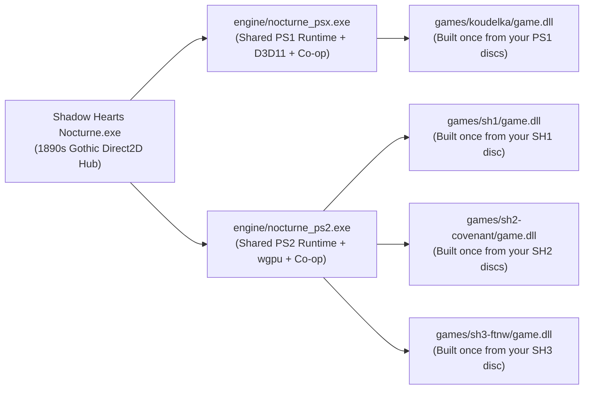

<div align="center">

# 🌙 Shadow Hearts: Nocturne

**The Complete Native Windows PC Port of the *Koudelka* & *Shadow Hearts* Quadrilogy (PS1 + PS2)**

[](https://github.com/NfgOdin/Shadow-Hearts-Nocturne/actions/workflows/ci.yml)
[](https://github.com/NfgOdin/Shadow-Hearts-Nocturne/releases)
[](https://github.com/NfgOdin/Shadow-Hearts-Nocturne/releases)
[](LICENSE)
[](#supported-collection-titles)

*Unified inside a single 1890s Gothic Direct2D Command Hub (`Shadow Hearts Nocturne.exe`), powered by native C++20 static recompilation (`psxrecomp` + customized `ps2-native-recomp`) with a Shared Engine + Per-Game `game.dll` architecture for 3–5 second updates, battle-tested Online & LAN Co-op, a 4-Layer Lua/C++ Mod Engine, and an interactive Grimoire Lore Library.*

[**⬇ Download Installer (`Install Shadow Hearts Nocturne.cmd`)**](https://github.com/NfgOdin/Shadow-Hearts-Nocturne/releases) · [**🚀 Quick Start**](#quick-start-5-minutes-to-play) · [**👥 Co-op Guide**](#8-online--lan-turn-authority-co-op-multiplayer) · [**📖 Full Tutorials**](#complete-step-by-step-tutorials) · [**🛠 FAQ**](#troubleshooting--faq)

</div>

---

> [!IMPORTANT]
> **Legal Notice — Bring Your Own Discs (BYOD):**
> This repository and its releases contain **ZERO** copyrighted game code, Sony BIOS files, disc images, extracted binaries, overlays, textures, audio, or saves. You must supply your own legally dumped **NTSC-U** disc images (`.iso`, `.chd`, `.cso`, or `.bin`/`.cue`). Each game's code is statically recompiled **locally on your own PC** into `games\<slug>\game.dll`.

---

## Table of Contents

- [Supported Collection Titles](#supported-collection-titles)
- [How It Works (Shared Engine + `game.dll` Fast Updates)](#how-it-works-shared-engine--gamedll-fast-updates)
- [Highlights & Feature Showcase](#highlights--feature-showcase)
  - [4-Panel Gothic Command Hub & 1890s Archives Library](#-4-panel-gothic-command-hub--1890s-archives-library)
  - [Koudelka (PS1) Native Engine & Visual Remaster Pack](#-koudelka-ps1-native-engine--visual-remaster-pack)
  - [Shadow Hearts I / II / III (PS2) Native Engine & Wave G Post-FX](#-shadow-hearts-i--ii--iii-ps2-native-engine--wave-g-post-fx)
  - [Online & LAN Turn-Authority Co-op Multiplayer](#-online--lan-turn-authority-co-op-multiplayer)
  - [4-Layer Gameplay Mod Engine & Mod Studio](#-4-layer-gameplay-mod-engine--mod-studio)
  - [Judgment Ring Dojo, `F1` Quick Menu, Save States & Trophies](#-judgment-ring-dojo-f1-quick-menu-save-states--trophies)
- [System Requirements](#system-requirements)
- [Quick Start (5 Minutes to Play)](#quick-start-5-minutes-to-play)
- [Complete Step-by-Step Tutorials](#complete-step-by-step-tutorials)
  - [1. Fresh Install Walkthrough (No Git or Visual Studio Required)](#1-fresh-install-walkthrough-no-git-or-visual-studio-required)
  - [2. Preparing & Verifying Your Disc Images](#2-preparing--verifying-your-disc-images)
  - [3. Updating (3–5 Second Quick Updates & Stable vs. Nightly)](#3-updating-35-second-quick-updates--stable-vs-nightly)
  - [4. Direct Launch & Steam Shortcuts (`--play`)](#4-direct-launch--steam-shortcuts---play)
  - [5. HD Texture Packs, Offline `.PKB` Extraction & AI 4× Upscaling](#5-hd-texture-packs-offline-pkb-extraction--ai-4-upscaling)
  - [6. HD FMV Packs & AI Video Upscaling](#6-hd-fmv-packs--ai-video-upscaling)
  - [7. Gameplay Mods (4-Layer Mod Engine, `.nocturne-mod` & Load Order)](#7-gameplay-mods-4-layer-mod-engine-nocturne-mod--load-order)
  - [8. Online & LAN Turn-Authority Co-op Multiplayer](#8-online--lan-turn-authority-co-op-multiplayer)
  - [9. Save Management, Memory Cards, Save States & Backups](#9-save-management-memory-cards-save-states--backups)
  - [10. Baking Captured VU1/VU0 Vector Microprograms](#10-baking-captured-vu1vu0-vector-microprograms)
  - [11. Controls, Gamepad Setup & Full Keyboard Shortcuts](#11-controls-gamepad-setup--full-keyboard-shortcuts)
- [Troubleshooting & FAQ](#troubleshooting--faq)
- [Folder Layout Reference](#folder-layout-reference)
- [Building & Testing From Source (Developers)](#building--testing-from-source-developers)
- [Credits & License](#credits--license)

---

## Supported Collection Titles

| # | Chronicle | Platform & Required NTSC-U Serial(s) | Discs | Local Game Module | Key Enhancements |
|---|---|---|---|---|---|
| **0** | **Koudelka** *(1898)* | PS1 `SLUS-01051` / `01100` / `01101` / `01102` | 4 | `games\koudelka\game.dll` | Native R3000A + GTE static recomp, D3D11 Hardware GPU (`1×`–`8×`) w/ draw-state caching & device-lost recovery, PGXP Subpixel + Persp UV, Visual Remaster Pack (FXAA, Gothic Bloom, Vignette, CAS, 1898 Candlelight, 24-bit Smooth De-Dithering), SPU1 Hardware Reverb + 4-tap ADPCM interpolation, `PSXSTAT3` atomic states (`<2 ms` handoffs), seamless 4-disc auto-swap, debounced atomic `memcard.mcr`, Exact Frame-Locked Co-op (up to 3P) |
| **I** | **Shadow Hearts** *(1913)* | PS2 `SLUS-20347` | 1 | `games\sh1\game.dll` | Full AOT static recomp, True 16:9 Hor+ (with automatic 1:1 2D field alignment protection), −16.7 ms Judgment Ring latency pipeline, 75-Trophy live system & Gallery, Area Autosave, Offline `.PKB` Texture & FMV Extractor (890 PNGs + 19 FMVs), 1-Click VU1 Baker, Co-op (up to 4P) |
| **II** | **Shadow Hearts: Covenant** *(1915)* | PS2 `SLUS-21041` (Disc 1) / `SLUS-21044` (Disc 2) | 2 | `games\sh2-covenant\game.dll` | Full AOT static recomp (`SLUS_210.41` + `OPENING`/`FIELD`/`BATTLE` `MWo3` overlays), seamless Disc 1 ↔ Disc 2 auto-swap with NTFS hardlink deduplication, True `16:9` / `21:9` / `32:9` Hor+ + HUD Anchoring, −16.7 ms Judgment Ring latency + Live Ring HUD & Strict Ring Mode, 110-Trophy Gallery, Area Autosave, Offline `.PKB` Extractor (~5,650 PNGs + 40 FMVs), Co-op (up to 4P) |
| **III** | **Shadow Hearts: From the New World** *(1929)* | PS2 `SLUS-21326` | 1 | `games\sh3-ftnw\game.dll` | Full AOT static recomp (`SLUS_213.26` + `.CPX` overlays), True Widescreen Hor+ + HUD Anchoring, −16.7 ms Judgment Ring latency + Live Ring HUD & Strict Ring Mode, Live Trophy Gallery, Area Autosave, Offline `.PKB` Extractor, `1×`–`64×` scaling + Depth Post-FX, Co-op (up to 4P) |

---

## How It Works (Shared Engine + `game.dll` Fast Updates)

Unlike older static-recompilation builds that baked the entire emulator runtime into every game's `.exe`, **Shadow Hearts: Nocturne** cleanly separates the open-source engine from your locally compiled game modules:



- **Compile each game once:** Your discs are unpacked into fast SSD folders and statically recompiled into `games\<slug>\game.dll` **one time**.
- **3–5 second Quick Updates:** Clicking **Quick Update** in the Launcher downloads the latest SHA-256-verified shared engine binaries (`Shadow Hearts Nocturne.exe`, `engine\nocturne_ps2.exe`, `engine\nocturne_psx.exe`), syncs bundled mods, and restarts—**zero game recompiling**.
- **Automatic ABI safety:** Every `game.dll` exports an ABI version + struct layout fingerprint. If a future update ever changes the recompiler ABI, the updater detects it automatically and rebuilds only the affected `game.dll` (preserving 100% of your saves, settings, mods, and unpacked discs).

---

## Highlights & Feature Showcase

### 🏰 4-Panel Gothic Command Hub & 1890s Archives Library
- **Quadrilogy Command Hub (`Shadow Hearts Nocturne.exe`):** Full Mouse, Keyboard, and XInput Gamepad navigation across all 4 chronicles (*Koudelka 1898*, *Shadow Hearts 1913*, *Covenant 1915*, *From the New World 1929*) with era-specific palettes, animated Judgment Ring crests, custom box art (`games\<slug>\cover.png`), live save/trophy summaries, playtime tracking, **Maximize/Restore & edge-drag resize** with uniform scaling & persisted window geometry, a **48-bitmap LRU VRAM cache**, and automatic unfocused timer pause.
- **1890s Grimoire Archives & Lore Library:** Browse Game Manuals, Strategy Guides, and Collector's Artbooks on leather-bound Grimoire tome shelves with book-open/page-flip animations, silk ribbon bookmarks, procedural page-turn audio, **Hide Unshelved** toggle, and an embedded **PDF & CBZ Reader** (WIC-accelerated with Zip-Slip protection).
- **One-Click Built-In Tools:** Stable/Nightly Quick Updater (with SHA-256 verification), System Health diagnostics, HD Texture/FMV Pack & Gameplay Mod manager (drag/reorder/toggle with conflict detection & per-mod settings UI), offline `.PKB` extraction & AI 4× upscaling, save/memcard backups, and screenshot galleries.

### 🕯 Koudelka (PS1) Native Engine & Visual Remaster Pack
- **D3D11 Hardware GPU (`1×`–`8×`) + PGXP:** Full hardware rasterizer with draw-state caching, automatic D3D11 device-lost recovery, **PGXP Subpixel Vertex Precision + Perspective-Correct UVs** (eliminates PS1 polygon wobble and texture warping), Sharp-3D filtering, and **DXGI `ALLOW_TEARING`** VSync-Off support (prevents 30 Hz TV/laptop throttling).
- **Phase 2 Visual Remaster Pack:** Real-time **FXAA**, **Gothic Bloom**, **Gothic Vignette**, **AMD CAS Sharpening**, **1898 Candlelight**, **24-bit Smooth De-Dithering**, and 4 curated visual presets—all hot-toggleable in `F1 → Graphics`.
- **Authentic SPU1 Hardware Audio:** **PS1 SPU1 Hardware Reverb** (`EON` + `vLOUT`/`vROUT`), **4-tap smooth B-spline/Gaussian ADPCM interpolation**, click-free `key_on_voice()`, exact 44.1 kHz ADSR & SPU IRQ9, continuous XA-ADPCM playback across Co-op checkpoints, and lock-free `SoundPipe` time-stretching.
- **Instant States & Safe Saves:** Atomic **`PSXSTAT3`** save states with zero-copy in-memory restore (`< 2 ms` handoff load skipping unused CPU VRAM upscaling), debounced atomic `memcard.mcr` saves, and seamless 4-disc auto-swapping.

### 🎨 Shadow Hearts I / II / III (PS2) Native Engine & Wave G Post-FX
- **−16.7 ms Judgment Ring Latency Pipeline:** Capped `post_present` frame queue + zero-lock **250 Hz controller polling** (`poll_port(0)`) for crisp, arcade-tight Judgment Ring timing.
- **High-Resolution Scaling & 16× Overlay Cache:** `1×`–`64×` internal resolution (with **Adaptive Scale**), single-pass GPU tile binning (`raster_gpu`), and a **4,096-entry `g_overlay_cache`** for smooth frame pacing.
- **True Hor+ Widescreen & Ultrawide:** `4:3`, `16:9`, `16:10`, `21:9`, `32:9`, `Auto`, and **HUD Anchoring** (keeps battle/field HUDs sharp on ultrawide monitors), with automatic 1:1 field alignment protection on *Shadow Hearts 1*'s pre-rendered backgrounds.
- **Depth-Aware & Modern Post-Processing (Live in `F1 → Graphics`):** Real-time **SSAO**, **HDR Bloom**, **SSGI Light Bounce**, **Filmic Tone Mapping**, **Gothic Vignette**, **AMD CAS Sharpening**, **FSR 1.0 (Quality / Ultra)**, **FXAA**, **Color Temperature**, **Animated Film Grain**, **CRT Aperture Grille / Shadow Mask**, **Mipmap LOD Bias**, and **Photo Mode (`F4`)**.
- **Unlocked & Monitor-Hz Frame Pacing:** `30` / `60` / `120` / `144` / `240` / `Match Display` / `Unlimited` with **High-FPS Speed Sync** (exact 48 kHz real-time audio + automatic 60 Hz FMV lock).

### 👥 Online & LAN Turn-Authority Co-op Multiplayer
Play through *Koudelka* (up to 3 players) or *Shadow Hearts I / II / III* (up to 4 players) together over the internet or LAN!
- **Exact Frame-Locked RNG Sync & 0 ms Local Authority:** The active player always has **0 ms local input latency** (critical for Judgment Ring timing!), while Koudelka spectators run exact `sys.frame_count` lockstep (`pop_exact` + exact 2× catch-up) so every damage roll, crit, miss, and enemy formation matches identically on both screens.
- **Smart Automatic Turn & Scene Sync:**
  - **Koudelka:** Auto-passes control on **Battle Turns** (`Koudelka` / `Edward` / `James`) and **Level-Up Bonus Points**, and automatically syncs **Battle Start**, **Battle Win → Field**, **Cutscenes / FMVs (`ov=7`)**, and **Field Room / Door Transfers (`scene_ptr`)**.
  - **Shadow Hearts II & III:** Live **Judgment Ring Callouts** (*Perfect!*, *Strike!*, *Miss!*) and **Relay Combo** baton passing between players!
- **Battle-Tested Netcode (`< 1%` Packet Loss, `1–2 ms` Handoffs):**
  - Background-threaded **Delta-LZ0** compression (3.5 MB state → ~200 KB in ~10 ms; zero frame hitch).
  - **48 KB in-flight UDP congestion window + 6 Mbps pacing** (eliminates residential router bufferbloat).
  - Automatic **Direct UDP hole-punching** with seamless fallback to the public **Nocturne Relay** (`137.131.24.235:47191`, or host your own via `tools/coop_relay/coop_relay.py`).
  - **Anti-Deadlock Guarantees:** Reliable `AuthorityAck` retries, 2.5s silent-peer auto-nudge watchdog, and **Host `F6 ×2` instant force-reclaim**.
  - **Isolated Co-op Campaigns & Shared Trophies:** Saves live under `games\<slug>\coop_saves\<campaign>\` with atomic memory card mirroring (never touches solo saves), plus automatic partner trophy sharing.
  - **Toggleable `F10` Live Debug Telemetry:** Press `F10` anytime for real-time FPS, RTT, Direct vs. Relay path, packet loss %, jitter buffer depth, and event history (`%TEMP%\nocturne_coop_live.txt`, deleted immediately when toggled OFF).

### 🧩 4-Layer Gameplay Mod Engine & Mod Studio
- **Layer 1 — Virtual Disc, Texture & Video Overrides:** Replace disc files (`files/`), HD textures (`textures/`), or HD FMVs (`video/`) non-destructively.
- **Layer 2 — `.pnach` RAM & Code Patches:** Standard PCSX2-style `patch=1,EE,...` hex patches.
- **Layer 3 — Embedded Lua Script Engine:** Lifecycle hooks (`on_boot`, `on_frame`, `on_battle_win`, `on_ring_perfect`, `on_hotkey`), 2D Gothic HUD Canvas, budgeted AOB/string RAM scanning, controller pad injection, path-jailed WAV SFX, persistent per-mod saves, and live **per-mod configurable settings UI** (Launcher + `F1 → MODS`).
- **Layer 4 — Native C++ `.dll` Plugin SDK:** Opt-in (`allow_native_plugins = 1`) via [`sdk/nocturne_mod_api.h`](sdk/nocturne_mod_api.h).
- **Bundled Showcase Mods & Mod Studio:** Ships with ready-to-toggle mods (`NemetonLantern` for Koudelka, `ChronicleUnleashed` for SH1, `CrimsonFlow` shared) plus **`Nocturne Mod Studio.cmd`** (6-tab visual/Lua/C++ workbench with `--mod-dev` auto hot-reload, `F9` reload, `F10` Live Modder Inspector, and 1-click `.nocturne-mod` export).

### 🎯 Judgment Ring Dojo, `F1` Quick Menu, Save States & Trophies
- **Judgment Ring Dojo & Strict Ring Challenge Mode:** Practice Judgment Ring timing right inside the Launcher's **Ring Dojo**, and toggle **Live Ring HUD** or **Strict Ring Challenge Mode** in-game for *Covenant* and *From the New World*.
- **`F1` Quick Menu (`Select+Start` / `Guide` on controller):** Live Graphics, Audio (Master, Music/Voices, SFX, UI Chime, Output Device, Audio Time-Stretch), Controls & Co-op, Mods, Save State browser, Photo Mode (`F4`), and full Trophy Gallery.
- **Area Autosave + 10 Save State Slots (`0`–`9`):** Compact LZ4-compressed states with live `160×112` thumbnails, area name, party level, playtime, and active disc metadata.
- **Clean Game-Only Screenshots (`F12`):** Lossless PNG captures organized per game in `%USERPROFILE%\Pictures\Shadow Hearts Nocturne\<Game>\`.

---

## System Requirements

| Component | Minimum | Recommended |
|---|---|---|
| **OS** | Windows 10 64-bit (1903+) | Windows 10 / 11 64-bit |
| **CPU** | 4-core x86-64 (AVX2 helpful for compile) | 6+ cores (faster initial `game.dll` build) |
| **RAM** | 8 GB | 16 GB+ |
| **GPU** | DirectX 11 / 12 / Vulkan capable GPU | Dedicated GPU (4 GB+ VRAM for `4×`–`8×` + HD Packs) |
| **Storage** | ~6–12 GB per installed game + ~2 GB portable toolchain | SSD (enables ~16× faster virtual disc loading) |
| **Software Needed** | **None!** (Portable Clang, CMake, Ninja, Python, SDL2, wgpu, DXC auto-download) | — |

---

## Quick Start (5 Minutes to Play)

1. **Download [`Install Shadow Hearts Nocturne.cmd`](https://github.com/NfgOdin/Shadow-Hearts-Nocturne/releases)** (a single ~9 KB script—no Git, Python, or Visual Studio needed!).
2. **Double-click `Install Shadow Hearts Nocturne.cmd`** *(if Windows SmartScreen appears, click **More info → Run anyway**—it's plain readable text you can inspect in Notepad)*.
3. Follow the **6-Step Guided Setup Walkthrough**:
   - Choose which game(s) to install (**All 4** or any single game).
   - Pick your install folder (default: `C:\ShadowHeartsNocturne`).
   - Point the **Smart ROM Scanner** at the folder containing your NTSC-U disc images (`.iso`, `.chd`, `.cso`, or `.bin`/`.cue`).
   - Confirm your CPU compile threads & optional Desktop/Start Menu shortcut.
4. Wait for the one-time local `game.dll` build to finish, then double-click **`Shadow Hearts Nocturne.exe`** and click **PLAY**!

---

## Complete Step-by-Step Tutorials

<details>
<summary><b>1. Fresh Install Walkthrough (No Git or Visual Studio Required)</b></summary>

1. Download **`Install Shadow Hearts Nocturne.cmd`** from the [Releases page](https://github.com/NfgOdin/Shadow-Hearts-Nocturne/releases).
2. Place it anywhere (e.g., Desktop or Downloads) and double-click it.
3. Choose your release channel (**Main** for playtest-verified Stable, or **Nightly** for bleeding-edge updates).
4. Choose an install directory—avoid `C:\Program Files\` so Windows UAC never blocks saves or quick updates (e.g., `C:\ShadowHeartsNocturne` or `D:\Games\ShadowHeartsNocturne`).
5. The installer downloads the repository, bootstraps the portable toolchain into `tools\portable\`, and launches the **6-Step Setup Walkthrough**:
   - **Step 1:** Pick which games to build (`[A]` All 4, or any combination of `1`–`4`).
   - **Step 2:** Confirm install folder.
   - **Step 3:** Scan a folder for your disc images (auto-identifies all 4 games by disc header!) or browse each disc individually.
   - **Step 4:** Pick a CPU thread preset (auto-tuned for your CPU & RAM so your PC stays responsive).
   - **Step 5:** Choose whether to create Desktop / Start Menu shortcuts and whether to keep your original ISO/CHD/BIN files (keeping backups is recommended).
   - **Step 6:** Review the summary and start!
6. Each disc is unpacked and verified **bit-for-bit**, translated to C++20, and compiled once into `games\<slug>\game.dll`.
7. When finished, launch **`Shadow Hearts Nocturne.exe`**.

</details>

<details>
<summary><b>2. Preparing & Verifying Your Disc Images</b></summary>

Only **NTSC-U (North America)** retail disc images are supported:

| Game | Required Serial(s) | Accepted Formats |
|---|---|---|
| **Koudelka** | `SLUS_010.51` (D1), `SLUS_011.00` (D2), `SLUS_011.01` (D3), `SLUS_011.02` (D4) | `.bin`+`.cue`, `.chd` |
| **Shadow Hearts** | `SLUS_203.47` | `.iso`, `.chd`, `.cso`, `.bin`+`.cue` |
| **Shadow Hearts: Covenant** | `SLUS_210.41` (D1), `SLUS_210.44` (D2) | `.iso`, `.chd`, `.cso`, `.bin`+`.cue` |
| **Shadow Hearts: From the New World** | `SLUS_213.26` | `.iso`, `.chd`, `.cso`, `.bin`+`.cue` |

**Tips:**
- **Smart Folder Scan:** Put all your discs in one folder (subfolders up to 4 levels deep are supported) and let Step 3 auto-detect every disc by reading `SYSTEM.CNF` / PS1 headers.
- **CHD files:** Native multi-threaded `chdunpack` handles ZSTD, LZMA, zlib, and FLAC `.chd` images automatically—no external tools needed.
- **Multi-disc games (Koudelka & Covenant):** Files identical across discs are deduplicated automatically (NTFS hardlinks on Covenant; shared virtual manifest on Koudelka) so you don't waste SSD space, and disc swapping happens **seamlessly in-game**.

</details>

<details>
<summary><b>3. Updating (3–5 Second Quick Updates & Stable vs. Nightly)</b></summary>

### From Inside the Launcher (Easiest — 1 Click)
1. Open **`Shadow Hearts Nocturne.exe`**.
2. Go to **Tools → Updates**.
3. Choose your channel:
   - **Stable (`main`):** Playtest-verified releases.
   - **Nightly (`nightly`):** Latest features and daily fixes.
4. Click **Quick Update**:
   - Downloads SHA-256-verified shared engine binaries (`Shadow Hearts Nocturne.exe`, `engine\nocturne_ps2.exe`, `engine\nocturne_psx.exe`), auto-upgrades bundled mods, verifies `game.dll` ABI compatibility, and restarts in **~3–5 seconds**.
   - **Zero game recompiling** unless a rare update bumps the recompiler ABI (in which case only the affected `game.dll` rebuilds automatically).

### From Command Line
```powershell
.\tools\portable\python\python.exe scripts\nocturne_update.py --channel main
```

</details>

<details>
<summary><b>4. Direct Launch & Steam Shortcuts (<code>--play</code>)</b></summary>

Launch any game directly through `Shadow Hearts Nocturne.exe` without opening the launcher UI—ideal for **Desktop shortcuts**, **Steam (Add a Non-Steam Game)**, or **Playnite / LaunchBox**:

```text
"C:\ShadowHeartsNocturne\Shadow Hearts Nocturne.exe" --play koudelka
"C:\ShadowHeartsNocturne\Shadow Hearts Nocturne.exe" --play sh1
"C:\ShadowHeartsNocturne\Shadow Hearts Nocturne.exe" --play sh2
"C:\ShadowHeartsNocturne\Shadow Hearts Nocturne.exe" --play sh3
```

**Optional flags:**
- `--fullscreen` or `--window` — Override your saved fullscreen preference.
- `--slot <0-9|auto>` — Boot straight into a save state slot or your latest Area Autosave (e.g., `--play sh2 --slot auto`).

</details>

<details>
<summary><b>5. HD Texture Packs, Offline <code>.PKB</code> Extraction & AI 4× Upscaling</b></summary>

### Installing Community HD Texture Packs
1. Place each texture pack in its own subfolder under `games\<slug>\texture_packs\<PackName>\` *(legacy `games\<slug>\mods\textures\` is also loaded automatically)*.
2. Open **`Shadow Hearts Nocturne.exe`** → **Tools → HD Packs & Mods**.
3. Toggle packs on/off and drag/reorder priority (higher packs override lower ones).
4. In-game, press **`F1 → Settings → Graphics → HD Textures`** to toggle live, or **Reload Packs** to hot-reload edits without restarting!

### Creating Your Own AI 4× HD Texture Pack (1-Click)
1. In the Launcher, go to **Tools → HD Packs & Mods**.
2. Click **Extract Disc Textures (Offline `.PKB`)** to dump every texture from your unpacked disc directly to `games\<slug>\dumps\textures\`.
3. Click **AI 4× Texture Upscale** (auto-downloads `realesrgan-ncnn-vulkan` and processes dumped PNGs into a ready-to-use pack under `texture_packs\`).

</details>

<details>
<summary><b>6. HD FMV Packs & AI Video Upscaling</b></summary>

1. Drop hardware-decoded `.mp4` replacement cutscenes into `games\<slug>\video_packs\<PackName>\` *(legacy `games\<slug>\mods\fmv\` is also supported)*.
2. Toggle **HD FMV** in **Launcher → Tools → HD Packs & Mods** or **`F1 → Settings → Graphics`**.
3. To upscale your own FMVs, use **Extract Disc FMVs** followed by **AI FMV Upscale** (`Real-ESRGAN` + `ffmpeg`) right inside the Launcher's Tools tab.

</details>

<details>
<summary><b>7. Gameplay Mods (4-Layer Mod Engine, <code>.nocturne-mod</code> & Load Order)</b></summary>

Shadow Hearts: Nocturne includes a **4-Layer Gameplay Mod Engine** (works on both PS2 and Koudelka PS1):
- **Layer 1 — Virtual Disc, Texture & Video Overrides:** Replace disc files (`files/`), HD textures (`textures/`), or HD FMVs (`video/`) without touching `disc_files\`.
- **Layer 2 — `.pnach` RAM & Code Patches:** Standard PCSX2-style `patch=1,EE,...` hex patches applied cleanly at boot/frame.
- **Layer 3 — Embedded Lua Script Engine:** Zero-hex Semantic Lua API (`on_battle_win`, `on_ring_perfect`, `on_hotkey`, persistent per-mod saves, custom Gothic HUD canvas, budgeted AOB scanning, path-jailed WAV SFX, and configurable per-mod settings).
- **Layer 4 — Native C++ `.dll` Plugin SDK:** Opt-in (`allow_native_plugins = 1`) via [`sdk/nocturne_mod_api.h`](sdk/nocturne_mod_api.h).

**Installing mods (players):**
1. Open **`Shadow Hearts Nocturne.exe`** → **Tools → Packs & Mods** → click **Import `.zip / .nocturne-mod`** (or extract into `games\<slug>\mods\<ModName>\`).
2. Enable, configure settings, or reorder mods — or hot-toggle them live in-game via **`F1 → MODS`**.

**Creating mods (modders & developers):**
- See the [**Modder's Handbook (`docs/MODDING_GUIDE.md`)**](docs/MODDING_GUIDE.md) and launch **`Nocturne Mod Studio.cmd`** from the repository root for the 6-tab visual + Lua + `.pnach` + C++ SDK workbench with `--mod-dev` auto hot-reload and the `F10` Live Modder Inspector.

</details>

<details>
<summary><b>8. Online & LAN Turn-Authority Co-op Multiplayer</b></summary>

Play *Koudelka* (up to 3 players) or *Shadow Hearts I / II / III* (up to 4 players) together!

### Hosting a Co-op Session
1. Open **`Shadow Hearts Nocturne.exe`**, select your game, and open the **Co-op Lobby** tab.
2. Enter your **Player Name** and a **Campaign Name** (saves are isolated in `games\<slug>\coop_saves\<campaign>\` so your solo saves are never touched).
3. Assign party character slots (`P1–P3` for Koudelka; `P1–P4` for Shadow Hearts).
4. Click **Host Room** — a 6-character **Room Code** is generated via the public Nocturne Relay (`137.131.24.235:47191`, or use LAN / your own relay).
5. Share the Room Code with your friends. Once everyone is in the lobby, click **Launch Together**!

### Joining a Friend's Session
1. Make sure you're on the same update commit (click **Quick Update** in **Tools → Updates** — takes 5 seconds!).
2. Open the **Co-op Lobby** tab for the same game, enter the **Room Code**, and click **Join Room**.
3. When the host clicks **Launch Together**, your game boots automatically, punches through to **Direct UDP** (or falls back seamlessly to Relay), and syncs!

### In-Game Co-op Controls
- **`F6` (Pass-the-Stick):** Hand control to the next player, or request control back. **Host `F6 ×2` (double-tap within 3s)** force-reclaims control immediately in any situation.
- **`F10` (Debug HUD & Live Telemetry):** Toggles the corner FPS/Co-op HUD and live 1 Hz telemetry (`%TEMP%\nocturne_coop_live.txt`, deleted immediately when toggled OFF).
- **`F1 → Settings → Co-op`:** Toggle Auto Battle-Turn, Relay Combos, Co-op HUD, Emote Pings, Party Slot Assignments, or trigger a manual **Resync**.

</details>

<details>
<summary><b>9. Save Management, Memory Cards, Save States & Backups</b></summary>

- **In-Game Memory Cards:**
  - PS2 games: `games\<slug>\memcard.ps2` (standard 8 MB PS2 memory card with ECC — compatible with PCSX2 / MyMC).
  - Koudelka (PS1): `games\koudelka\memcard.mcr` (standard 128 KB PS1 memory card — atomic debounced writes, compatible with DuckStation / MemcardRex).
  - Automatic rotating backups are stored in `games\<slug>\backups\`.
- **Save States (`F5` / `F8`):**
  - Stored in `games\<slug>\states\` (`slot_0.state` through `slot_9.state` plus `autosave.state`).
  - **Area Autosave** automatically saves `autosave.state` when entering a new field room (never mid-battle or mid-cutscene).
- **Backup & Restore:** Use the **Saves** tab in `Shadow Hearts Nocturne.exe` to inspect save-slot details, launch directly into any slot, or create/restore timestamped backups.

</details>

<details>
<summary><b>10. Baking Captured VU1/VU0 Vector Microprograms</b></summary>

PS2 games dynamically upload small vector programs to VU1/VU0 during gameplay. Nocturne automatically compiles unseen vector programs in the background (`vu1-live\`) so gameplay stays smooth.

To permanently bake all captured VU1/VU0 programs into your `game.dll`:
1. Open **`Shadow Hearts Nocturne.exe`** → **Tools → System Health**.
2. Check **VU1 Cache** — if any unbaked captures exist, click **Bake VU1 Programs** (or run option `[9]` in `Shadow Hearts Nocturne Setup.cmd`).
3. Takes ~5–15 seconds and eliminates future live-compile hitches permanently.

</details>

<details>
<summary><b>11. Controls, Gamepad Setup & Full Keyboard Shortcuts</b></summary>

### Gamepad Support
- Plug-and-play **XInput** (Xbox 360 / One / Series), **DualShock 4 / DualSense**, **Switch Pro**, and **DirectInput** controllers via SDL2 (with safe hot-plug/removal handling).
- Open **`F1 → Settings → Controls → Change keys`** in-game (or edit `games\<slug>\keys.ini`) to customize every button or stick deadzone.

### Universal Shortcuts

| Key / Combo | Action |
|---|---|
| **`F1`** *(or `Select+Start` / `Guide`)* | Open / close the **Quick Menu Hub** |
| **`F2`** | Cycle picture filter / sharpness style |
| **`F4`** | Toggle **Photo Mode** (freeze frame, free-look, hide 2D HUD) |
| **`F5`** | Quick Save to active slot (`0–9`) or open Slot Picker |
| **`F6`** | **Solo:** Previous Save State slot · **Co-op:** Pass-the-Stick (`F6 ×2` on Host = instant force-reclaim) |
| **`F7`** | Next Save State slot (`0–9`) |
| **`F8`** | Quick Load from active slot (`0–9`) — automatically syncs partners in Co-op |
| **`F9`** | Write diagnostic problem report (or hot-reload mods in `--mod-dev` mode) |
| **`F10`** | Toggle **Debug FPS/Co-op HUD & Live Telemetry** (or Modder Inspector in `--mod-dev` mode) |
| **`F11`** *(or `Alt+Enter`)* | Toggle Fullscreen / Windowed |
| **`F12`** | Take clean game-only PNG screenshot |
| **`Tab`** *(or `Select+R2`)* | Hold for Turbo Fast-Forward (solo play) |
| **`Q` / `E`** *(or `L1` / `R1`)* | Switch Quick Menu tabs / Trophy Gallery tiers |

</details>

---

## Troubleshooting & FAQ

<details>
<summary><b>Windows SmartScreen says "Windows protected your PC" when running the installer</b></summary>

This happens for any newly downloaded `.cmd` or unsigned indie `.exe` on Windows.
- Click **More info** → **Run anyway**.
- `Install Shadow Hearts Nocturne.cmd` is a plain-text batch/PowerShell script—you can right-click → **Edit in Notepad** to inspect every line before running it.

</details>

<details>
<summary><b>Windows Defender / Antivirus flags <code>game.dll</code>, <code>clang++.exe</code>, or <code>Shadow Hearts Nocturne.exe</code></b></summary>

Because the setup compiles brand-new unsigned native binaries (`game.dll`) on your PC, antivirus heuristics may quarantine them or slow down compilation.
- **Fix:** Add your install folder (e.g., `C:\ShadowHeartsNocturne`) to **Windows Security → Virus & threat protection → Exclusions → Add a folder**.
- If a file was already quarantined, restore it or run `Shadow Hearts Nocturne Setup.cmd` → **`[T]` Repair Toolchain**.

</details>

<details>
<summary><b>"Disc image not recognized" or wrong region (PAL / NTSC-J)</b></summary>

Currently only **NTSC-U (USA)** retail discs are supported:
- Koudelka: `SLUS-01051` / `01100` / `01101` / `01102`
- Shadow Hearts: `SLUS-20347`
- Shadow Hearts: Covenant: `SLUS-21041` / `SLUS-21044`
- Shadow Hearts: From the New World: `SLUS-21326`

PAL (`SLES-*`) and Japanese (`SLPS-*` / `SLPM-*`) dumps have different memory layouts and code addresses and will not match the AOT tables.

</details>

<details>
<summary><b>Koudelka <code>.bin</code>/<code>.cue</code> fails to unpack or has missing audio/FMV</b></summary>

- Make sure you have **all 4 discs** in `.bin`/`.cue` (Mode 2/2352 raw sector dumps) or `.chd` format—truncated 2048-byte `.iso` rips of PS1 games strip XA audio/STR video subheaders and will fail verification.
- Keep each `.cue` in the same folder as its matching `.bin` file(s).

</details>

<details>
<summary><b>Black screen, DX12/Vulkan crash, or low VRAM warning on launch</b></summary>

1. Update your GPU drivers (NVIDIA / AMD / Intel).
2. Make sure `dxcompiler.dll` and `dxil.dll` are present in the install root (check **Launcher → Tools → System Health**; if missing, run `Shadow Hearts Nocturne Setup.cmd` → **`[T]` Repair Toolchain**).
3. Try lowering **Resolution Scale** (`2×` or `4×`) or switching **GPU API** (`DX12` ↔ `Vulkan`) in **Launcher → Settings → Graphics** (or `F1 → Graphics`).
4. For Koudelka PS1, you can also toggle **Renderer** between **D3D11 Hardware GPU** and **Software CPU** in the Launcher or `F1` menu.

</details>

<details>
<summary><b>Audio crackling, speed issues, or Judgment Ring feeling slightly off</b></summary>

- Enable **Audio Time-Stretch** (`F1 → Settings → Audio`) for smooth pitch-locked audio during minor frame dips.
- If using a 120 Hz / 144 Hz / 240 Hz monitor, keep **High-FPS Speed Sync** **ON** (`F1 → Settings → Graphics`) so game logic & audio stay locked to exact real-time.
- For lowest Judgment Ring latency, use **VSync Off / Immediate** in `F1 → Graphics`.

</details>

<details>
<summary><b>Co-op won't connect or screens drift out of sync</b></summary>

1. Verify both players are on the **exact same update commit** (click **Quick Update** in **Tools → Updates** — takes ~5 seconds!).
2. Allow `Shadow Hearts Nocturne.exe`, `engine\nocturne_ps2.exe`, and `engine\nocturne_psx.exe` through **Windows Defender Firewall** (Private & Public networks).
3. Verify both players use the same **Relay URL** in the Co-op Lobby (default: `137.131.24.235:47191`).
4. In-game, press **`F6 ×2`** on Host to force-reclaim control anytime, or **`F1 → Co-op → Resync`** to snap all players together.

</details>

<details>
<summary><b>Controller not detected or double-inputs</b></summary>

- If running alongside Steam, disable **Steam Input Desktop Configuration** (or launch via Steam using `--play <game>`).
- Connect your controller *before* launching the game, or unplug/replug—SDL2 hot-plugs automatically.
- Check button mappings in `F1 → Settings → Controls → Change keys`.

</details>

<details>
<summary><b>Where are logs & how do I report a bug?</b></summary>

1. Press **`F9`** in-game (or open `games\<slug>\logs\`) to grab the latest log file. For Co-op bugs, press **`F10`** to capture live telemetry in `%TEMP%\nocturne_coop_live.txt`.
2. Open a [GitHub Issue](https://github.com/NfgOdin/Shadow-Hearts-Nocturne/issues) with your game, commit hash (**Launcher → Tools → Updates**), GPU/OS, and log file.

</details>

---

## Folder Layout Reference

```text
ShadowHeartsNocturne\
├── Shadow Hearts Nocturne.exe      # Unified 4-Game Gothic Launcher & Archives Library
├── Shadow Hearts Nocturne Setup.cmd# Interactive Setup, Updater & Repair CLI
├── Nocturne Mod Studio.cmd         # 6-Tab Visual / Lua / .pnach / C++ Mod Workbench
├── launcher.ini                    # Global launcher preferences & update channel
├── SDL2.dll, dxcompiler.dll, ...   # Shared runtime DLLs (zero duplicates per game)
├── engine\
│   ├── nocturne_ps2.exe            # Shared PS2 engine (runs SH1, SH2, SH3)
│   └── nocturne_psx.exe            # Shared PS1 engine (runs Koudelka)
└── games\
    ├── koudelka\
    │   ├── game.dll                # Locally compiled Koudelka AOT module
    │   ├── disc_files\             # Deduplicated 4-disc virtual library
    │   ├── memcard.mcr             # 128 KB PS1 Memory Card (atomic saves)
    │   ├── keys.ini                # Per-game video, audio & control settings
    │   ├── states\                 # PSXSTAT3 save states (slot_0..9.state + autosave.state)
    │   ├── coop_saves\             # Isolated Co-op campaigns & mirrored memcards
    │   ├── achievements.json       # Koudelka trophy progress
    │   └── mods\ & backups\ & logs\
    ├── sh1\                        # Shadow Hearts (1913) — game.dll, disc_files\, memcard.ps2...
    ├── sh2-covenant\               # Covenant (1915) — game.dll, disc1_files\, disc2_files\...
    └── sh3-ftnw\                   # From the New World (1929) — game.dll, disc_files\...

%USERPROFILE%\Pictures\Shadow Hearts Nocturne\
├── Koudelka\
├── Shadow Hearts\
├── Covenant\
└── From the New World\
```

---

## Building & Testing From Source (Developers)

Requires **Clang (`llvm-mingw`) with C++20**, **CMake 3.20+**, and **Ninja** (all bundled automatically by `scripts/portable.ps1`). MSVC and GCC are unsupported due to Clang vector builtins (`__builtin_elementwise_min`, `__builtin_reduce_or`).

Automated CI builds and runs **21 CTest + Python regression suites** on every push to `main` and `nightly` (`.github/workflows/ci.yml`), and `.github/workflows/release-engine.yml` publishes prebuilt Windows shared engine updates automatically.

```powershell
# 1. Load portable toolchain onto PATH (required for windres + clang++)
. .\tools\portable\env.ps1

# 2. Configure & build the shared engine + launcher (zero game discs required!)
cmake -S . -B build/engine -G Ninja -DCMAKE_BUILD_TYPE=Release -DCMAKE_CXX_COMPILER=clang++ `
  -DPS2_WGPU_DIR="$PWD/third_party/wgpu-native" -DCMAKE_PREFIX_PATH="$PWD/third_party/sdl2"
ninja -j 2 -C build/engine sh2launcher nocturne_ps2 nocturne_psx

# 3. Build & run all 21 disc-free C++ & Python regression suites via CTest
ninja -j 2 -C build/engine ps2cooptest ps2modenginetest ps2gamedlltest ps2launchertest `
  psxgtetest psxrecomptest psxdisctest psxgpusputest `
  ps2thbasetest ps2sifcmdtest ps2savetest ps2discinputtest ps2iopboundstest ps2vuregtest
ctest --test-dir build/engine --output-on-failure
```

For deep engine architecture notes (`SDRV_IOP`, `IOPUTY`, `FIO`, `MWo3` overlays, GPU tile binning, `SSHSys::DiskChange`), see [`SHADOW_HEARTS_COVENANT.md`](SHADOW_HEARTS_COVENANT.md) and [`docs/MODDING_GUIDE.md`](docs/MODDING_GUIDE.md).

---

## Credits & License

- Built on [`ps2-native-recomp`](https://github.com/exoteric33/ps2-native-recomp) and [`ps2-web-recomp`](https://github.com/snuri00/ps2-web-recomp) by Samir Nuri, plus a custom PS1 R3000A static recompiler (`psxrecomp`).
- Released under the **MIT License** — see [`LICENSE`](LICENSE). MPEG VLC tables adapted from [Play!](https://github.com/jpd002/Play-) (BSD 2-Clause, see `runtime/src/ipu/NOTICE`).
- *Koudelka*, *Shadow Hearts*, *Shadow Hearts: Covenant*, and *Shadow Hearts: From the New World* are trademarks of their respective copyright holders; PlayStation and PS2 are trademarks of Sony Interactive Entertainment. This project is an independent fan-made static-recompilation engine and is not affiliated with or endorsed by Sony or any game publisher.
