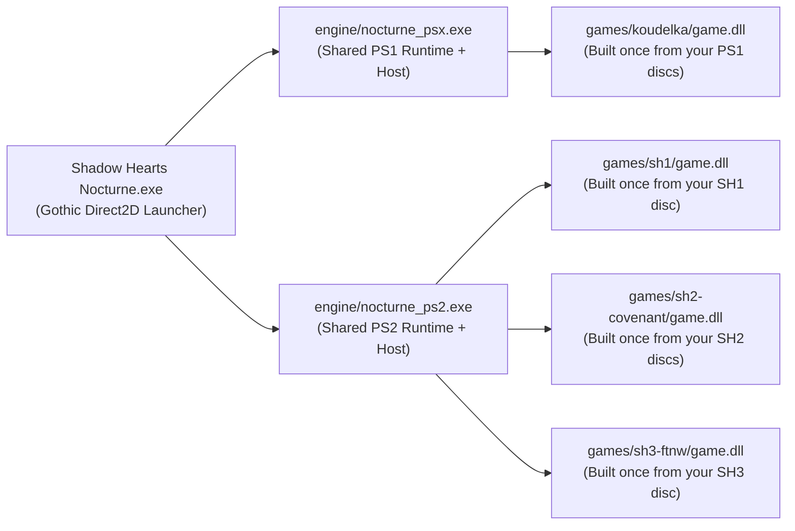

<div align="center">

# 🌙 Shadow Hearts: Nocturne

**The Complete Native Windows PC Port of the *Koudelka* & *Shadow Hearts* Quadrilogy (PS1 + PS2)**

[](https://github.com/NfgOdin/Shadow-Hearts-Nocturne/releases)
[](https://github.com/NfgOdin/Shadow-Hearts-Nocturne/releases)
[](LICENSE)
[](#supported-collection-titles)

*Unified inside a single Gothic Direct2D Command Hub (`Shadow Hearts Nocturne.exe`), powered by static C++20 recompilation (`psxrecomp` + customized `ps2-native-recomp`) with a Shared Engine + Per-Game `game.dll` architecture for 3–5 second updates.*

[**⬇ Download Installer (`Install Shadow Hearts Nocturne.cmd`)**](https://github.com/NfgOdin/Shadow-Hearts-Nocturne/releases) · [**🚀 Quick Start**](#quick-start-5-minutes-to-play) · [**📖 Full Tutorials**](#complete-step-by-step-tutorials) · [**🛠 Troubleshooting & FAQ**](#troubleshooting--faq)

</div>

---

> [!IMPORTANT]
> **Legal Notice — Bring Your Own Discs (BYOD):**
> This repository and its releases contain **ZERO** copyrighted game code, Sony BIOS files, disc images, extracted binaries, overlays, textures, audio, or saves. You must supply your own legally dumped **NTSC-U** disc images (`.iso`, `.chd`, `.cso`, or `.bin`/`.cue`). Each game's code is statically recompiled **locally on your own PC** into `games\<slug>\game.dll`.

---

## Table of Contents

- [Supported Collection Titles](#supported-collection-titles)
- [How It Works (Shared Engine + `game.dll` Fast Updates)](#how-it-works-shared-engine--gamedll-fast-updates)
- [Highlights & Feature Showcase](#highlights--feature-showcase)
- [System Requirements](#system-requirements)
- [Quick Start (5 Minutes to Play)](#quick-start-5-minutes-to-play)
- [Complete Step-by-Step Tutorials](#complete-step-by-step-tutorials)
  - [1. Fresh Install Walkthrough (No Git or Visual Studio Required)](#1-fresh-install-walkthrough-no-git-or-visual-studio-required)
  - [2. Preparing & Verifying Your Disc Images](#2-preparing--verifying-your-disc-images)
  - [3. Updating (3–5 Second Quick Updates & Stable vs. Nightly)](#3-updating-35-second-quick-updates--stable-vs-nightly)
  - [4. Direct Launch & Steam Shortcuts (`--play`)](#4-direct-launch--steam-shortcuts---play)
  - [5. HD Texture Packs, Offline `.PKB` Extraction & AI 4× Upscaling](#5-hd-texture-packs-offline-pkb-extraction--ai-4-upscaling)
  - [6. HD FMV Packs & AI Video Upscaling](#6-hd-fmv-packs--ai-video-upscaling)
  - [7. Gameplay Mods (`.pnach` Patches, File Overrides & Load Order)](#7-gameplay-mods-pnach-patches-file-overrides--load-order)
  - [8. Online & LAN Turn-Authority Co-op Multiplayer](#8-online--lan-turn-authority-co-op-multiplayer)
  - [9. Save Management, Memory Cards, Save States & Backups](#9-save-management-memory-cards-save-states--backups)
  - [10. Baking Captured VU1/VU0 Vector Microprograms](#10-baking-captured-vu1vu0-vector-microprograms)
  - [11. Controls, Gamepad Setup & Full Keyboard Shortcuts](#11-controls-gamepad-setup--full-keyboard-shortcuts)
- [Troubleshooting & FAQ](#troubleshooting--faq)
- [Folder Layout Reference](#folder-layout-reference)
- [Building & Testing From Source (Developers)](#building--testing-from-source-developers)
- [Credits & License](#credits--license)

---

## Supported Collection Titles

| # | Chronicle | Platform & Required NTSC-U Serial(s) | Discs | Local Game Module | Highlights |
|---|---|---|---|---|---|
| **0** | **Koudelka** *(1898)* | PS1 `SLUS-01051` / `01100` / `01101` / `01102` | 4 | `games\koudelka\game.dll` | Native R3000A + GTE static recomp, D3D11 Hardware GPU (`1×`–`8×`), PGXP subpixel & perspective UV, Sharp-3D filtering, 24-bit Smooth De-Dithering, 4 Visual Presets, MDEC FMV + XA-ADPCM & 24-voice SPU1, seamless 4-disc auto-swap, PS1 Memory Card (`memcard.mcr`), Trophy System, Co-op (up to 3P) |
| **I** | **Shadow Hearts** *(1913)* | PS2 `SLUS-20347` | 1 | `games\sh1\game.dll` | Full AOT static recomp, True 16:9 Hor+ (with 1:1 2D field alignment protection), 75-Trophy live system & Gallery, Area Autosave, Offline `.PKB` Texture & FMV Extractor (890 PNGs + 19 FMVs), 1-Click VU1 Baker, Co-op |
| **II** | **Shadow Hearts: Covenant** *(1915)* | PS2 `SLUS-21041` (Disc 1) / `SLUS-21044` (Disc 2) | 2 | `games\sh2-covenant\game.dll` | Full AOT static recomp (`SLUS_210.41` + `OPENING`/`FIELD`/`BATTLE` `MWo3` overlays), seamless Disc 1 ↔ Disc 2 auto-swap with NTFS hardlink deduplication, True 16:9 / 21:9 / 32:9 Hor+, 110-Trophy live system & Gallery, Area Autosave, Offline `.PKB` Extractor (~5,650 PNGs + 40 FMVs), Judgment Ring HUD, Co-op |
| **III** | **Shadow Hearts: From the New World** *(1929)* | PS2 `SLUS-21326` | 1 | `games\sh3-ftnw\game.dll` | Full AOT static recomp (`SLUS_213.26` + `.CPX` overlays), True Widescreen Hor+, Live Trophy System & Gallery, Area Autosave, Judgment Ring HUD, Offline `.PKB` Extractor, High-Res `1×`–`64×` scaling, Depth Post-FX, Co-op |

---

## How It Works (Shared Engine + `game.dll` Fast Updates)

Unlike older static-recompilation builds that baked the entire emulator runtime into every game's `.exe`, **Shadow Hearts: Nocturne** cleanly separates the open-source engine from your locally compiled game modules:



- **Compile each game once:** Your discs are unpacked into fast SSD folders and statically recompiled into `games\<slug>\game.dll` **one time**.
- **3–5 second Quick Updates:** When we ship launcher, graphics, audio, mod, or co-op updates, clicking **Quick Update** in the Launcher simply downloads the updated open-source engine binaries (`Shadow Hearts Nocturne.exe`, `engine\nocturne_ps2.exe`, `engine\nocturne_psx.exe`) and restarts—**zero game recompiling**.
- **Automatic ABI safety:** Every `game.dll` exports an ABI version + struct layout fingerprint. If a rare future update ever changes the recompiler ABI, the updater detects it automatically and rebuilds only the affected `game.dll` (preserving all saves, settings, mods, and unpacked discs).

---

## Highlights & Feature Showcase

### 🏰 4-Panel Gothic Quadrilogy Command Hub (`Shadow Hearts Nocturne.exe`)
- **Full Quadrilogy Launcher:** Navigate all 4 chronicles (*Koudelka 1898*, *Shadow Hearts 1913*, *Covenant 1915*, *From the New World 1929*) with Mouse, Keyboard, or XInput Gamepad—each themed to its era's palette, animated Judgment Ring crests, live save/trophy summaries, playtime tracker, and optional custom box art (`games\<slug>\cover.png`).
- **One-Click Built-In Tools:** Check & apply updates (Stable or Nightly), inspect System Health, manage HD Texture Packs, HD FMV Packs, and Gameplay Mods (drag/reorder/toggle with conflict detection), run offline `.PKB` extraction & AI 4× upscaling, back up/restore memory cards, and open screenshot galleries.

### 🎨 Modern PC Graphics, Widescreen & Wave G Post-FX
- **High-Resolution Scaling:** `1×`–`64×` internal resolution on PS2 (with **Adaptive Scale** to lock silky-smooth frame pacing) and `1×`–`8×` D3D11 Hardware GPU + **PGXP** (subpixel vertex precision + perspective-correct UVs) + **24-bit Smooth De-Dithering** on Koudelka PS1.
- **True Hor+ Widescreen & Ultrawide:** `4:3`, `16:9`, `16:10`, `21:9`, `32:9`, `Auto`, and **HUD Anchoring** (keeps battle/field HUDs crisp on ultrawide monitors), with automatic 1:1 field protection on *Shadow Hearts 1*'s pre-rendered backgrounds.
- **Depth-Aware & Modern Post-Processing (Live in `F1 → Graphics`):** Real-time **SSAO**, **HDR Bloom**, **SSGI Light Bounce**, **Filmic Tone Mapping**, **Gothic Vignette**, **AMD CAS Sharpening**, **FSR 1.0 (Quality / Ultra)**, **FXAA**, **Color Temperature**, **Animated Film Grain**, **CRT Aperture Grille / Shadow Mask**, **Mipmap LOD Bias**, and **Photo Mode (`F4`)**.
- **Unlocked & Monitor-Hz Frame Pacing:** `30` / `60` / `120` / `144` / `240` / `Match Display` / `Unlimited` with **High-FPS Speed Sync** (exact 48 kHz real-time audio + automatic 60 Hz FMV lock) and single-pass GPU tile binning (`raster_gpu`).

### 👥 Online & LAN Turn-Authority Co-op Multiplayer
- Play through *Koudelka*, *Shadow Hearts*, *Covenant*, or *From the New World* together with friends!
- **Co-op Lobby built into the Launcher:** Host or join via **Room Code** through the built-in Nocturne Relay (`137.131.24.235:47191`, or point to your own relay/LAN IP).
- **Turn-Authority Controls:** Assign party slots (`1`–`4`) to players, auto-pass control on turn change, trigger **Relay Combos**, sync trophies live across partners, and keep co-op campaigns safely isolated under `games\<slug>\coop_saves\<campaign>\`.

### 🎯 Judgment Ring Dojo & Strict Ring Challenge Mode
- Practice Judgment Ring timing right inside the Launcher's **Ring Dojo** (tracks personal best streaks and perfect hits).
- Toggle **Ring HUD** or **Strict Ring Challenge Mode** (tracks unbroken zero-miss streaks live in-game for *Covenant* and *From the New World*).

### 💾 `F1` Quick Menu, Area Autosave, LZ4 Save States & Trophy Galleries
- **`F1` Quick Menu (`Select+Start` / `Guide` on controller):** Live Graphics, Audio (Master, Music/Voices, SFX, UI Chime, Output Device, Audio Time-Stretch), Controls & Co-op tabs, Save State browser, Photo Mode, and full Trophy Gallery.
- **Area-Transition Autosave + 10 Save State Slots (`0`–`9`):** Compact LZ4-compressed `~10 MB` states at any resolution with live `160×112` thumbnails, area name, party level, playtime, and active disc metadata.
- **Clean Game-Only Screenshots (`F12`):** Lossless PNG captures organized per game in `%USERPROFILE%\Pictures\Shadow Hearts Nocturne\<Game>\`.

---

## System Requirements

| Component | Minimum | Recommended |
|---|---|---|
| **OS** | Windows 10 64-bit (1903+) | Windows 10 / 11 64-bit |
| **CPU** | 4-core x86-64 (AVX2 helpful for compile) | 6+ cores (faster initial `game.dll` build) |
| **RAM** | 8 GB | 16 GB+ |
| **GPU** | DirectX 12 / Vulkan capable GPU | Dedicated GPU (4 GB+ VRAM for `4×`–`8×` + HD Packs) |
| **Storage** | ~6–12 GB per installed game + ~2 GB portable toolchain | SSD (enables ~16× faster virtual disc loading) |
| **Software Needed** | **None!** (Portable Clang, CMake, Ninja, Python, SDL2, wgpu, DXC auto-download) | — |

---

## Quick Start (5 Minutes to Play)

1. **Download [`Install Shadow Hearts Nocturne.cmd`](https://github.com/NfgOdin/Shadow-Hearts-Nocturne/releases)** (a single ~9 KB file—no Git, Python, or Visual Studio needed!).
2. **Double-click `Install Shadow Hearts Nocturne.cmd`** *(if Windows SmartScreen appears, click **More info → Run anyway**—the script is plain readable text you can inspect in Notepad)*.
3. Follow the **6-Step Guided Setup Walkthrough**:
   - Choose which game(s) to install (**All 4** or any single game).
   - Pick your install folder (default: `C:\ShadowHeartsNocturne`).
   - Point the **Smart ROM Scanner** at the folder containing your NTSC-U disc images (`.iso`, `.chd`, `.cso`, or `.bin`/`.cue`).
   - Confirm your CPU compile threads & optional Desktop/Start Menu shortcut.
4. Wait for the one-time local `game.dll` build to finish, then double-click **`Shadow Hearts Nocturne.exe`** and click **PLAY**!

---

## Complete Step-by-Step Tutorials

<details>
<summary><b>1. Fresh Install Walkthrough (No Git or Visual Studio Required)</b></summary>

1. Download **`Install Shadow Hearts Nocturne.cmd`** from the [Releases page](https://github.com/NfgOdin/Shadow-Hearts-Nocturne/releases).
2. Place it anywhere (e.g., Desktop or Downloads) and double-click it.
3. Choose your release channel (**Nightly** is default during beta; **Main** is Stable).
4. Choose an install directory—avoid `C:\Program Files\` so Windows UAC never blocks saves or quick updates (e.g., `C:\ShadowHeartsNocturne` or `D:\Games\ShadowHeartsNocturne`).
5. The installer downloads the repository, bootstraps the portable toolchain into `tools\portable\`, and launches the **6-Step Setup Walkthrough**:
   - **Step 1:** Pick which games to build (`[A]` All 4, or any combination of `1`–`4`).
   - **Step 2:** Confirm install folder.
   - **Step 3:** Scan a folder for your disc images (auto-identifies all 4 games by disc header!) or browse each disc individually.
   - **Step 4:** Pick a CPU thread preset (auto-tuned for your CPU & RAM so your PC stays responsive).
   - **Step 5:** Choose whether to create Desktop / Start Menu shortcuts and whether to keep your original ISO/CHD/BIN files (keeping backups is recommended).
   - **Step 6:** Review the summary and start!
6. Each disc is unpacked and verified **bit-for-bit**, translated to C++20, and compiled once into `games\<slug>\game.dll`.
7. When finished, launch **`Shadow Hearts Nocturne.exe`**.

</details>

<details>
<summary><b>2. Preparing & Verifying Your Disc Images</b></summary>

Only **NTSC-U (North America)** retail disc images are supported:

| Game | Required Serial(s) | Accepted Formats |
|---|---|---|
| **Koudelka** | `SLUS_010.51` (D1), `SLUS_011.00` (D2), `SLUS_011.01` (D3), `SLUS_011.02` (D4) | `.bin`+`.cue`, `.chd` |
| **Shadow Hearts** | `SLUS_203.47` | `.iso`, `.chd`, `.cso`, `.bin`+`.cue` |
| **Shadow Hearts: Covenant** | `SLUS_210.41` (D1), `SLUS_210.44` (D2) | `.iso`, `.chd`, `.cso`, `.bin`+`.cue` |
| **Shadow Hearts: From the New World** | `SLUS_213.26` | `.iso`, `.chd`, `.cso`, `.bin`+`.cue` |

**Tips:**
- **Smart Folder Scan:** Put all your discs in one folder (subfolders up to 4 levels deep are supported) and let Step 3 auto-detect every disc by reading `SYSTEM.CNF` / PS1 headers.
- **CHD files:** Native multi-threaded `chdunpack` handles ZSTD, LZMA, zlib, and FLAC `.chd` images automatically—no external tools needed.
- **Multi-disc games (Koudelka & Covenant):** Files identical across discs are deduplicated automatically (NTFS hardlinks on Covenant; shared virtual manifest on Koudelka) so you don't waste SSD space, and disc swapping happens **seamlessly in-game**.

</details>

<details>
<summary><b>3. Updating (3–5 Second Quick Updates & Stable vs. Nightly)</b></summary>

### From Inside the Launcher (Easiest — 1 Click)
1. Open **`Shadow Hearts Nocturne.exe`**.
2. Go to **Tools → Updates**.
3. Choose your channel:
   - **Stable (`main`):** Playtest-verified releases.
   - **Nightly (`nightly`):** Latest features, Koudelka/SH1/SH3 improvements, and daily fixes.
4. Click **Quick Update**:
   - The launcher closes briefly, downloads the updated shared engine binaries (`Shadow Hearts Nocturne.exe`, `engine\nocturne_ps2.exe`, `engine\nocturne_psx.exe`), checks that your `game.dll` files are ABI-compatible, and restarts the launcher in **~3–5 seconds**.
   - **No game recompiling** unless a rare update changes the recompiler ABI (in which case a console window opens automatically to rebuild only the affected `game.dll`).

### Migrating From an Older Pre-`game.dll` Install
If you already had an older install with `Koudelka.exe`, `SH1.exe`, `SH2C.exe`, or `SH3.exe`:
- Just run **Update** once (from the Launcher or `Shadow Hearts Nocturne Setup.cmd`).
- The updater automatically detects your installed games, builds `games\<slug>\game.dll` once using your already-unpacked `disc_files\` (zero disc re-ripping!), removes the obsolete per-game `.exe`, and preserves **100% of your saves, `keys.ini`, and mods**.
- Every update after that is a 3–5 second Quick Update!

### From Command Line
```powershell
.\tools\portable\python\python.exe scripts\nocturne_update.py --channel nightly
```

</details>

<details>
<summary><b>4. Direct Launch & Steam Shortcuts (<code>--play</code>)</b></summary>

You can launch any game directly through `Shadow Hearts Nocturne.exe` without opening the launcher UI—ideal for **Desktop shortcuts**, **Steam (Add a Non-Steam Game)**, or **Playnite / LaunchBox**:

```text
"C:\ShadowHeartsNocturne\Shadow Hearts Nocturne.exe" --play koudelka
"C:\ShadowHeartsNocturne\Shadow Hearts Nocturne.exe" --play sh1
"C:\ShadowHeartsNocturne\Shadow Hearts Nocturne.exe" --play sh2
"C:\ShadowHeartsNocturne\Shadow Hearts Nocturne.exe" --play sh3
```

**Optional flags:**
- `--fullscreen` or `--window` — Override your saved fullscreen preference.
- `--slot <0-9|auto>` — Boot straight into a save state slot or your latest Area Autosave (e.g., `--play sh2 --slot auto`).

</details>

<details>
<summary><b>5. HD Texture Packs, Offline <code>.PKB</code> Extraction & AI 4× Upscaling</b></summary>

### Installing Community HD Texture Packs
1. Place each texture pack in its own subfolder under:
   ```text
   games\<slug>\texture_packs\<PackName>\
   ```
   *(Legacy `games\<slug>\mods\textures\` is also still loaded automatically.)*
2. Open **`Shadow Hearts Nocturne.exe`** → **Tools → HD Packs & Mods**.
3. Toggle packs on/off and drag/reorder priority (higher packs override lower ones).
4. In-game, press **`F1 → Settings → Graphics → HD Textures`** to toggle live, or **Reload Packs** to hot-reload edits without restarting!

### Creating Your Own AI 4× HD Texture Pack (1-Click)
1. In the Launcher, go to **Tools → HD Packs & Mods**.
2. Click **Extract Disc Textures (Offline `.PKB`)** to dump every texture from your unpacked disc directly to `games\<slug>\dumps\textures\` (no need to play through the whole game to dump textures!).
3. Click **AI 4× Texture Upscale** (auto-downloads `realesrgan-ncnn-vulkan` and processes dumped PNGs into a ready-to-use pack under `texture_packs\`).

</details>

<details>
<summary><b>6. HD FMV Packs & AI Video Upscaling</b></summary>

1. Drop hardware-decoded `.mp4` replacement cutscenes into:
   ```text
   games\<slug>\video_packs\<PackName>\
   ```
   *(Legacy `games\<slug>\mods\fmv\` is also supported.)*
2. Toggle **HD FMV** in **Launcher → Tools → HD Packs & Mods** or **`F1 → Settings → Graphics`**.
3. To upscale your own FMVs, use **Extract Disc FMVs** followed by **AI FMV Upscale** (`Real-ESRGAN` + `ffmpeg`) right inside the Launcher's Tools tab.

</details>

<details>
<summary><b>7. Gameplay Mods (<code>.pnach</code> Patches, File Overrides & Load Order)</b></summary>

Shadow Hearts: Nocturne includes a 3-layer **Gameplay Mod Engine** (works on both PS2 and Koudelka PS1):
- **Layer 1 — Virtual Disc File Overrides:** Replace any file inside the unpacked disc without touching your original `disc_files\`.
- **Layer 2 — `.pnach` RAM Patches:** Standard PCSX2-style `patch=1,EE,...` hex patches applied cleanly at boot/frame.
- **Layer 3 — Script Hooks:** Lightweight gameplay/balance tweaks.

**How to install a mod:**
1. Extract the mod folder into `games\<slug>\mods\<ModName>\`.
2. Open **`Shadow Hearts Nocturne.exe`** → **Tools → HD Packs & Mods**.
3. Enable the mod, adjust its priority, and check the built-in **Conflict Detector** (warns if two mods patch the same RAM address or override the same file).

</details>

<details>
<summary><b>8. Online & LAN Turn-Authority Co-op Multiplayer</b></summary>

Play *Koudelka* (up to 3 players) or *Shadow Hearts 1 / 2 / 3* (up to 4 players) together!

### Hosting a Co-op Session
1. Open **`Shadow Hearts Nocturne.exe`**, select your game, and open the **Co-op Lobby** tab.
2. Enter your **Player Name** and a **Campaign Name** (saves are isolated in `games\<slug>\coop_saves\<campaign>\` so your solo saves are never overwritten).
3. Click **Host Room** — a short **Room Code** is generated via the public Nocturne Relay (`137.131.24.235:47191`, or enter a custom LAN/Relay IP).
4. Share the Room Code with your friends. Once everyone is in the lobby, click **Launch Together**!

### Joining a Friend's Session
1. Open the **Co-op Lobby** tab for the same game.
2. Paste your friend's **Room Code** and click **Join Room**.
3. When the host clicks **Launch Together**, your game boots automatically and syncs!

### In-Game Co-op Controls (`F1 → Settings → Controls & Co-op`)
- **Pass Control** / **Auto-Turn Pass** — Automatically hand control to whichever player owns the active character's party slot (`Slot 1`–`4`).
- **Relay Combos** — Chain Judgment Ring combos across connected players.
- **Resync** — Re-synchronize state anytime if someone hits a brief lag spike.
- **Co-op Trophy Sync** — Unlocked achievements automatically share across partners.

</details>

<details>
<summary><b>9. Save Management, Memory Cards, Save States & Backups</b></summary>

- **In-Game Memory Cards:**
  - PS2 games: `games\<slug>\memcard.ps2` (standard 8 MB PS2 memory card with ECC — compatible with PCSX2 / MyMC!).
  - Koudelka (PS1): `games\koudelka\memcard.mcr` (standard 128 KB PS1 memory card — compatible with DuckStation / MemcardRex!).
  - Automatic rotating backups are created whenever a card is modified or backed up in `games\<slug>\backups\`.
- **Save States (`F5` / `F8`):**
  - Stored in `games\<slug>\states\` (`slot_0.state` through `slot_9.state` plus `autosave.state`).
  - Use **`F6` / `F7`** to cycle slots, or enable the **Slot Picker** in `F1 → Settings → Controls`.
  - **Area Autosave** automatically saves `autosave.state` when you enter a new field room (never during battles or cutscenes).
- **Backup & Restore:** Use the **Saves** tab in `Shadow Hearts Nocturne.exe` to inspect save-slot details, launch directly into any slot, or create/restore timestamped backups.

</details>

<details>
<summary><b>10. Baking Captured VU1/VU0 Vector Microprograms</b></summary>

PS2 games dynamically upload small vector programs to VU1/VU0 during gameplay. Nocturne automatically compiles unseen vector programs in the background (`vu1-live\`) so gameplay stays smooth.

If you ever notice a tiny one-time hitch when entering a brand-new spell or area, you can permanently bake all captured VU1/VU0 programs into your `game.dll`:
1. Open **`Shadow Hearts Nocturne.exe`** → **Tools → System Health**.
2. Check **VU1 Cache** — if any unbaked captures exist, click **Bake VU1 Programs** (or run option `[9]` in `Shadow Hearts Nocturne Setup.cmd`).
3. Takes ~5–15 seconds and eliminates future live-compile hitches permanently.

</details>

<details>
<summary><b>11. Controls, Gamepad Setup & Full Keyboard Shortcuts</b></summary>

### Gamepad Support
- Plug-and-play **XInput** (Xbox 360 / One / Series), **DualShock 4 / DualSense**, **Switch Pro**, and **DirectInput** controllers via SDL2.
- Open **`F1 → Settings → Controls → Change keys`** in-game (or edit `games\<slug>\keys.ini`) to customize every button or stick deadzone.

### Universal Shortcuts

| Key / Combo | Action |
|---|---|
| **`F1`** *(or `Select+Start` / `Guide`)* | Open / close the **Quick Menu Hub** |
| **`F2`** | Cycle picture filter / sharpness style |
| **`F4`** | Toggle **Photo Mode** (freeze frame & free-look/clean capture) |
| **`F5`** | Quick Save to active slot (`0–9`) or open Slot Picker |
| **`F6` / `F7`** | Previous / Next Save State slot (`0–9`) |
| **`F8`** | Quick Load from active slot (`0–9`) or open Slot Picker |
| **`F9`** | Write diagnostic problem report (for bug reports) |
| **`F11`** *(or `Alt+Enter`)* | Toggle Fullscreen / Windowed |
| **`F12`** | Take clean game-only PNG screenshot |
| **`Q` / `E`** *(or `L1` / `R1`)* | Switch Quick Menu tabs / Trophy Gallery tiers |

</details>

---

## Troubleshooting & FAQ

<details>
<summary><b>Windows SmartScreen says "Windows protected your PC" when running the installer</b></summary>

This happens for any newly downloaded `.cmd` or unsigned indie `.exe` on Windows.
- Click **More info** → **Run anyway**.
- `Install Shadow Hearts Nocturne.cmd` is a plain-text batch/PowerShell script—you can right-click → **Edit in Notepad** to inspect every single line before running it.

</details>

<details>
<summary><b>Windows Defender / Antivirus flags <code>game.dll</code>, <code>clang++.exe</code>, or <code>Shadow Hearts Nocturne.exe</code></b></summary>

Because the setup compiles brand-new unsigned native binaries (`game.dll`) on your PC, some antivirus heuristics may quarantine them or slow down compilation dramatically.
- **Fix:** Add your install folder (e.g., `C:\ShadowHeartsNocturne`) to **Windows Security → Virus & threat protection → Exclusions → Add a folder**.
- If a file was already quarantined, restore it or run `Shadow Hearts Nocturne Setup.cmd` → **`[T]` Repair Toolchain** / re-run the game's builder.

</details>

<details>
<summary><b>"Disc image not recognized" or wrong region (PAL / NTSC-J)</b></summary>

Currently only **NTSC-U (USA)** retail discs are supported:
- Koudelka: `SLUS-01051` / `01100` / `01101` / `01102`
- Shadow Hearts: `SLUS-20347`
- Shadow Hearts: Covenant: `SLUS-21041` / `SLUS-21044`
- Shadow Hearts: From the New World: `SLUS-21326`

PAL (`SLES-*`) and Japanese (`SLPS-*` / `SLPM-*`) dumps have different memory layouts and code addresses and will not match the AOT tables.

</details>

<details>
<summary><b>Koudelka <code>.bin</code>/<code>.cue</code> fails to unpack or has missing audio/FMV</b></summary>

- Make sure you have **all 4 discs** in `.bin`/`.cue` (Mode 2/2352 raw sector dumps) or `.chd` format—truncated 2048-byte `.iso` rips of PS1 games strip XA audio/STR video subheaders and will fail verification.
- Keep each `.cue` in the same folder as its matching `.bin` file(s).

</details>

<details>
<summary><b>Black screen, DX12/Vulkan crash, or low VRAM warning on launch</b></summary>

1. Update your GPU drivers (NVIDIA / AMD / Intel).
2. Make sure `dxcompiler.dll` and `dxil.dll` are present in the install root (check **Launcher → Tools → System Health**; if missing, run `Shadow Hearts Nocturne Setup.cmd` → **`[T]` Repair Toolchain**).
3. Try lowering **Resolution Scale** (`2×` or `4×`) or switching **GPU API** (`DX12` ↔ `Vulkan`) in **Launcher → Settings → Graphics** (or `F1 → Graphics`).
4. For Koudelka PS1, you can also toggle **Renderer** between **D3D11 Hardware GPU** and **Software CPU** in the Launcher or `F1` menu.

</details>

<details>
<summary><b>Audio crackling, speed issues, or Judgment Ring feeling slightly off</b></summary>

- Enable **Audio Time-Stretch** (`F1 → Settings → Audio`) for smooth pitch-locked audio during minor frame dips.
- If using a 120 Hz / 144 Hz / 240 Hz monitor, make sure **High-FPS Speed Sync** is **ON** (`F1 → Settings → Graphics`) so game logic & audio stay locked to exact real-time while rendering smoothly.
- For authentic Judgment Ring timing, try **VSync / Present Mode** settings in `F1 → Graphics` (Immediate/Mailbox gives lowest input latency).

</details>

<details>
<summary><b>"ABI mismatch in game.dll" after an update</b></summary>

This means the shared engine's recompiler ABI was upgraded and your old `game.dll` needs a one-time rebuild.
- Run **Quick Update** (or `Shadow Hearts Nocturne Setup.cmd` → **Update**) — it will automatically detect the mismatch and rebuild only the affected `game.dll` while keeping all your saves, settings, mods, and unpacked discs safe.

</details>

<details>
<summary><b>Co-op won't connect / stuck waiting for partner</b></summary>

1. Verify both players are running the **exact same game** and **same update commit** (check **Tools → Updates** in the Launcher).
2. Allow `Shadow Hearts Nocturne.exe`, `engine\nocturne_ps2.exe`, and `engine\nocturne_psx.exe` through **Windows Defender Firewall** (Private & Public networks) when prompted.
3. Make sure both players use the same **Relay URL** in the Co-op Lobby (default: `137.131.24.235:47191`).

</details>

<details>
<summary><b>Controller not detected or double-inputs</b></summary>

- If running alongside Steam, disable **Steam Input Desktop Configuration** (or launch via Steam using `--play <game>`).
- Connect your controller *before* launching the game, or unplug/replug—SDL2 hot-plugs automatically.
- Check button mappings in `F1 → Settings → Controls → Change keys`.

</details>

<details>
<summary><b>Where are logs & how do I report a bug?</b></summary>

1. Press **`F9`** in-game (or open `games\<slug>\logs\`) to grab the latest log file.
2. Open a [GitHub Issue](https://github.com/NfgOdin/Shadow-Hearts-Nocturne/issues) and include:
   - Which game & commit hash (shown in **Launcher → Tools → Updates**).
   - Your GPU / OS / Resolution Scale.
   - Steps to reproduce + the log file from `games\<slug>\logs\`.

</details>

---

## Folder Layout Reference

```text
ShadowHeartsNocturne\
├── Shadow Hearts Nocturne.exe      # Unified 4-Game Gothic Launcher (only user-facing EXE)
├── Shadow Hearts Nocturne Setup.cmd# Interactive Setup, Updater & Repair CLI
├── launcher.ini                    # Global launcher preferences & update channel
├── SDL2.dll, dxcompiler.dll, ...   # Shared runtime DLLs (zero duplicates per game)
├── engine\
│   ├── nocturne_ps2.exe            # Shared PS2 engine (runs SH1, SH2, SH3)
│   └── nocturne_psx.exe            # Shared PS1 engine (runs Koudelka)
└── games\
    ├── koudelka\
    │   ├── game.dll                # Locally compiled Koudelka AOT module
    │   ├── disc_files\             # Deduplicated 4-disc virtual library
    │   ├── memcard.mcr             # 128 KB PS1 Memory Card
    │   ├── keys.ini                # Per-game video, audio & control settings
    │   ├── states\                 # Save states (slot_0..9.state + autosave.state)
    │   ├── achievements.json       # Koudelka trophy progress
    │   ├── mods\ & backups\ & logs\
    ├── sh1\                        # Shadow Hearts (1913) — game.dll, disc_files\, memcard.ps2...
    ├── sh2-covenant\               # Covenant (1915) — game.dll, disc1_files\, disc2_files\...
    └── sh3-ftnw\                   # From the New World (1929) — game.dll, disc_files\...

%USERPROFILE%\Pictures\Shadow Hearts Nocturne\
├── Koudelka\
├── Shadow Hearts\
├── Covenant\
└── From the New World\
```

---

## Building & Testing From Source (Developers)

Requires **Clang (`llvm-mingw`) with C++20**, **CMake 3.20+**, and **Ninja** (all bundled automatically by `scripts/portable.ps1`). MSVC and GCC are unsupported due to Clang vector builtins (`__builtin_elementwise_min`, `__builtin_reduce_or`).

```powershell
# 1. Load portable toolchain onto PATH
. .\tools\portable\env.ps1

# 2. Configure & build the shared engine + launcher (zero game discs required!)
cmake -S . -B build/engine -G Ninja -DCMAKE_BUILD_TYPE=Release -DCMAKE_CXX_COMPILER=clang++ `
  -DPS2_WGPU_DIR="$PWD/third_party/wgpu-native" -DCMAKE_PREFIX_PATH="$PWD/third_party/sdl2"
ninja -C build/engine sh2launcher nocturne_ps2 nocturne_psx

# 3. Build & run disc-free C++ regression tests
ninja -C build/engine ps2gamedlltest ps2launchertest psxgtetest psxrecomptest psxdisctest psxgpusputest `
  ps2thbasetest ps2sifcmdtest ps2savetest ps2discinputtest ps2iopboundstest ps2vuregtest
.\build\engine\ps2gamedlltest.exe
.\build\engine\ps2launchertest.exe
```

For deep engine architecture notes (`SDRV_IOP`, `IOPUTY`, `FIO`, `MWo3` overlays, GPU tile binning, `SSHSys::DiskChange`), see [`SHADOW_HEARTS_COVENANT.md`](SHADOW_HEARTS_COVENANT.md).

---

## Credits & License

- Built on [`ps2-native-recomp`](https://github.com/exoteric33/ps2-native-recomp) and [`ps2-web-recomp`](https://github.com/snuri00/ps2-web-recomp) by Samir Nuri, plus a custom PS1 R3000A static recompiler (`psxrecomp`).
- Released under the **MIT License** — see [`LICENSE`](LICENSE). MPEG VLC tables adapted from [Play!](https://github.com/jpd002/Play-) (BSD 2-Clause, see `runtime/src/ipu/NOTICE`).
- *Koudelka*, *Shadow Hearts*, *Shadow Hearts: Covenant*, and *Shadow Hearts: From the New World* are trademarks of their respective copyright holders; PlayStation and PS2 are trademarks of Sony Interactive Entertainment. This project is an independent fan-made static-recompilation engine and is not affiliated with or endorsed by Sony or any game publisher.
